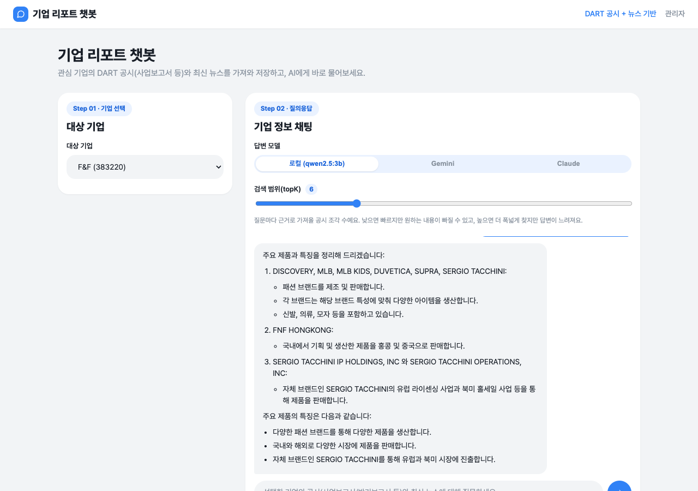
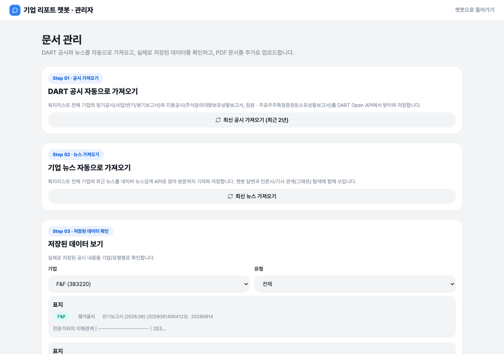
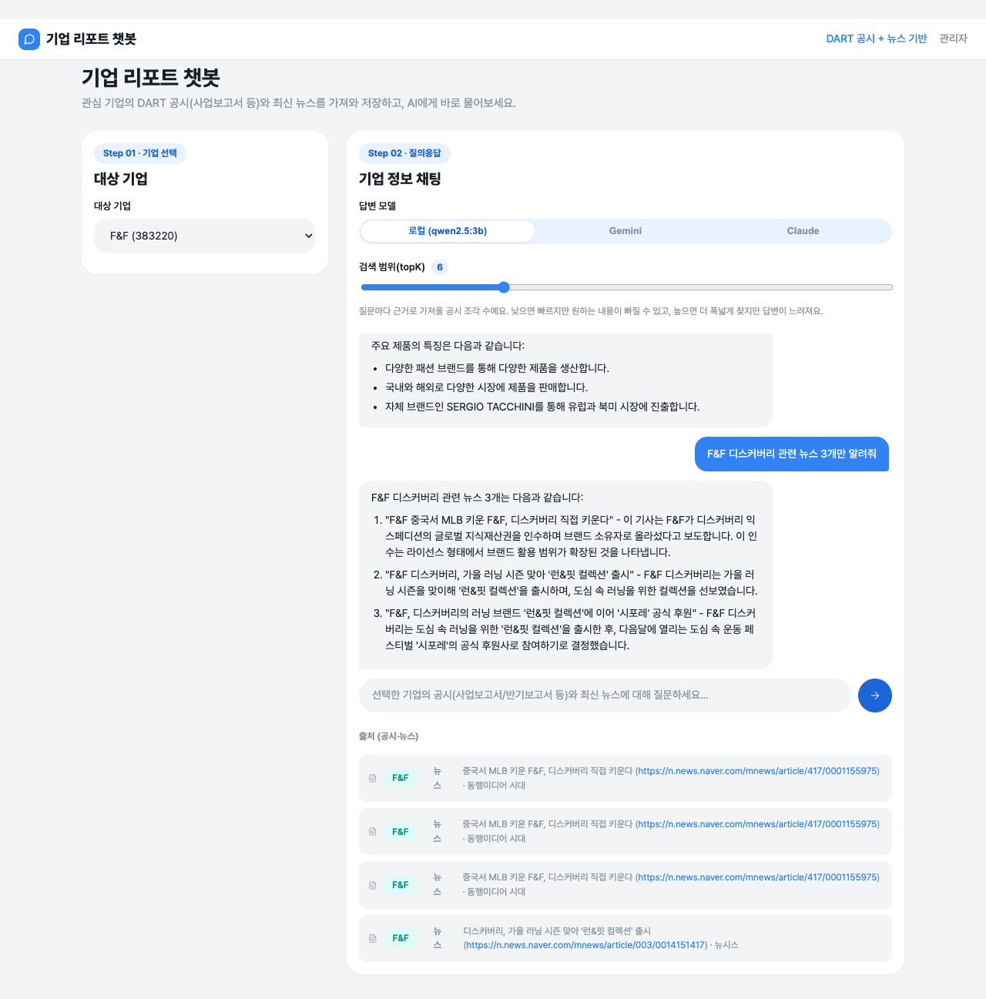
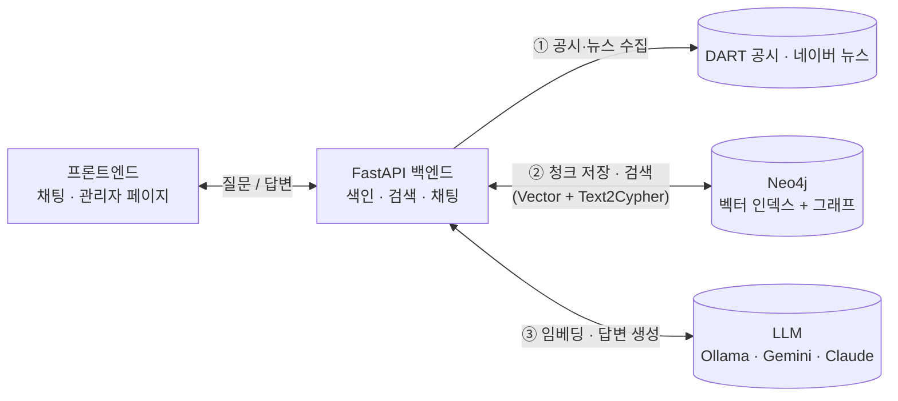
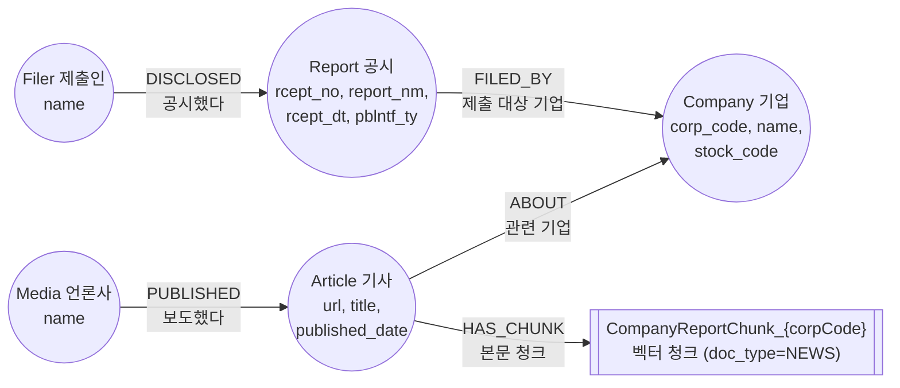

# 기업 리포트 챗봇(RAG)

DART 전자공시(사업/반기/분기보고서 + 지분공시)와 관련 뉴스를 근거로 관심 기업에
답변하는 RAG 챗봇입니다. 공시는 DART API, 뉴스는 네이버 검색결과 페이지(API 키
불필요)에서 가져와 기업별 Neo4j 벡터 인덱스에 함께 저장합니다. 지분공시 제출인과
뉴스 기사 관계는 그래프로도 저장해서, 벡터 검색(Vector Retriever)만으로 안 되는
집계·랭킹 질문은 LLM이 즉석에서 만든 Cypher(Text2Cypher)로 답합니다. 로컬(Ollama)/
Gemini/Claude 중 답변 모델을 골라 비교할 수 있고, 답변은 마크다운으로 렌더링됩니다.

## 사용 화면



기업을 고르고 질문하면 답변과 함께 근거 공시(회사명/보고서명/접수번호/섹션)를
보여줍니다. 답변 모델(로컬/Gemini/Claude)과 검색 범위(topK)를 조절할 수 있고,
표/목록이 포함된 답변은 마크다운으로 렌더링됩니다.


답변 생성 중에는 타이핑 인디케이터(점 3개)가 표시됩니다.



관리자 페이지(`/admin.html`)에서 공시를 한 번에 가져오고, Neo4j에 저장된 청크를
기업/유형별로 확인할 수 있습니다. PDF 업로드와 지분공시 그래프 탐색도 여기서.



뉴스 질문("F&F 디스커버리 관련 뉴스 3개만 알려줘")을 하면 실제 뉴스 기사가
근거로 잡히고, 출처에 "뉴스" 태그와 원문 링크가 함께 표시됩니다.


유형을 "뉴스"로 필터링하면 색인된 기사 목록을 확인하고, URL을 클릭해 원문으로
바로 이동할 수 있습니다.

## 아키텍처



- **① 공시·뉴스 수집**: DART 공시(XML)는 목차 단위로 분해, 뉴스는 네이버 검색결과·
  기사 페이지를 파싱(API 키 불필요)해서 본문을 가져옵니다. 둘 다 청킹 후 같은 기업
  전용 Neo4j 인덱스에 저장되고(뉴스는 `doc_type=NEWS`로 구분), 지분공시 제출인/뉴스
  기사-언론사 관계는 그래프로도 함께 기록됩니다. 변경 없는 공시·이미 수집한 기사
  URL은 재수집하지 않습니다.
- **② 검색**: 질문을 임베딩해 기업 전용 인덱스에서 유사도 검색(Vector Retriever,
  뉴스 키워드면 `doc_type=NEWS`로 필터). 집계·랭킹처럼 벡터 검색만으로 안 되는
  그래프 질문이면 LLM이 즉석에서 Cypher를 생성해 실행(Text2Cypher), 실패하면 고정
  조회로 폴백합니다.
- **③ 답변**: 대화 히스토리가 있으면 먼저 후속 질문을 독립형으로 재작성한 뒤, 위
  검색 결과를 근거로 로컬(Ollama)/Gemini/Claude 중 선택한 모델이 답변을 생성합니다.

## 그래프 DB 스키마

지분공시 제출인 관계와 뉴스 기사 관계를 하나의 Neo4j 그래프로 구성합니다(참고:
[graphrag-tools-retriever](https://github.com/gongwon-nayeon/graphrag-tools-retriever)의 뉴스 그래프 스키마 구조를 참고해
`Company` 노드를 공시 그래프와 뉴스 그래프가 공유하도록 확장했습니다).



- **Company (기업)**: 워치리스트 기업 (`corp_code`가 유일키) — 지분공시 그래프와 뉴스
  그래프가 공유하는 중심 노드
- **Report (공시)**: DART 공시 1건 (`rcept_no`가 유일키), `Company`에 `FILED_BY`(제출
  대상 기업)로 연결
- **Filer (제출인)**: 지분공시 제출인, `Report`에 `DISCLOSED`(공시했다)로 연결
  (대량보유상황보고서/임원·주요주주소유보고서에서만 생성)
- **Article (기사)**: 뉴스 기사 1건 (`url`이 유일키), `Company`에 `ABOUT`(관련 기업)으로
  연결, 실제 본문이 담긴 벡터 청크 노드에 `HAS_CHUNK`(본문 청크)로 연결
- **Media (언론사)**: 언론사, `Article`에 `PUBLISHED`(보도했다)로 연결

이 스키마는 Text2Cypher 라우터 프롬프트에 그대로 포함되어 LLM이 보고 Cypher를 생성합니다.

## 그래프 생성 과정

그래프는 답변 시점이 아니라 **공시·뉴스를 색인할 때** Neo4j에 기록합니다. 관계의
원천은 DART 목록과 수집한 뉴스의 메타데이터입니다. 공시·기사 본문 전체에서 LLM으로
개체와 관계를 추출해 지식 그래프를 만드는 방식은 아닙니다.

1. **공시** — [`company_report_index.py`](app/services/company_report_index.py)의
   `CompanyReportIndexService._index_disclosure()`가 DART 목록의 공시마다
   [`disclosure_graph.py`](app/services/disclosure_graph.py)의 `DisclosureGraphService.record_disclosure()`를
   호출합니다. `corp_code`로 `Company`, `rcept_no`로 `Report`를 `MERGE`하고
   `Report-[:FILED_BY]->Company`를 연결합니다. 지분공시(`pblntf_ty=D`)는 목록의
   `flr_nm`(제출인)이 비어 있지 않고 대상 기업명과 다를 때 `Filer`를 만들고
   `Filer-[:DISCLOSED]->Report`를 연결합니다. 공시 XML 본문은 별도로 섹션 분리·청킹해
   기업별 벡터 인덱스에 저장하며, 공시 청크와 `Report` 사이에 직접 관계를 만들지는
   않습니다. 검색 시 청크의 `rcept_no` 메타데이터로 해당 `Report`를 찾습니다.
2. **뉴스** — [`news_ingest.py`](app/services/news_ingest.py)의
   `NewsIngestService._ingest_article()`가 기사 본문을 청킹해 기업별 벡터 인덱스에 저장한 뒤,
   [`news_graph.py`](app/services/news_graph.py)의 `NewsGraphService.record_article()`을
   호출합니다. 기사 URL로 `Article`, 검색 대상 기업의 `corp_code`로 `Company`를
   `MERGE`해 `Article-[:ABOUT]->Company`로 연결합니다. 언론사 정보가 있으면
   `Media-[:PUBLISHED]->Article`을 만들고, 저장된 뉴스 청크 ID로
   `Article-[:HAS_CHUNK]->청크`를 연결합니다. 본문에서 언급된 다른 기업을 자동
   추출해 `ABOUT` 관계를 추가하지는 않습니다.

## 검색 전략: Vector Retriever + Text2Cypher

[graphrag-tools-retriever](https://github.com/gongwon-nayeon/graphrag-tools-retriever)의
`ToolsRetriever`(검색 방식을 통합하는 구조)에서 아이디어를 가져왔습니다. 매 질문마다
벡터 검색을 수행하고, 그래프 조회는 Text2Cypher를 시도한 뒤 필요하면 검색된 청크에
연결된 관계를 고정 Cypher로 확장합니다.

1. **Vector Retriever** — 질문을 임베딩해 기업 전용 인덱스에서 유사도 상위 topK개
   청크 조회. "뉴스/기사" 키워드가 있으면 `doc_type='NEWS'` 필터를 추가로 걸되, Neo4j
   필터가 ANN 검색 이후 적용되는 post-filter라 후보군을 넉넉히(200개) 가져온 뒤 잘라
   씁니다(안 그러면 후보에 뉴스가 하나도 안 걸려 0건이 될 수 있음).
2. **Text2Cypher** — 집계·랭킹처럼 벡터 검색만으로 안 되는 그래프 질문이면 LLM이
   스키마를 보고 Cypher를 생성해 읽기 전용으로 실행. 쓰기 구문은 정규식으로 차단하고,
   쿼리를 생성하지 않거나 실행 실패·결과 없음이면 검색된 지분공시 청크의 `rcept_no`와
   뉴스 청크의 `article_url`을 기준으로 고정 Cypher 관계 확장
   (`expand_retrieved_context`)을 수행합니다. 해당 청크가 없으면 그래프 확장을 건너뜁니다.

## 기술 스택

- **Backend**: Python 3.11+, FastAPI + Uvicorn, Pydantic Settings(`.env` 설정)
- **LLM/임베딩**: Ollama (`qwen2.5:3b` 채팅, `bge-m3` 임베딩) 기본, 선택적으로
  Google Gemini(`httpx`로 generateContent REST 직접 호출) 또는 Claude(로그인된
  `claude -p` CLI를 서브프로세스로 호출 — API 키 없이 claude.ai 구독 계정 그대로 사용)
- **벡터스토어**: Neo4j 공식 Python 드라이버로 직접 구현(기업마다 별도 라벨/인덱스로
  분리), 지분공시·뉴스 그래프도 같은 Neo4j에 저장. 청킹은 `tiktoken` 토큰 기준
- **문서 파싱**: 공시 XML은 `lxml`, PDF는 `pypdf`
- **뉴스 수집**: `httpx` + BeautifulSoup으로 네이버 뉴스 검색결과/기사 페이지를 직접
  파싱 (Selenium·공식 API 키 불필요)
- **외부 API**: DART(전자공시시스템) Open API, Google Gemini API(선택)
- **Frontend**: Vue 3 + TypeScript + Vite, 대화 히스토리는 브라우저 IndexedDB에 저장.
  답변은 `marked`로 마크다운 파싱 후 `DOMPurify`로 sanitize해 렌더링. 빌드 결과는
  `static/`에 커밋되어 있어 Node 없이도 바로 실행됩니다.

## 실행 방법

### 1) 사전 준비

**Python 3.11 이상**과 가상환경:

```bash
python3 -m venv .venv
source .venv/bin/activate
pip install -e ".[dev]"
```

**Ollama** (로컬에서 실행 중이어야 함):

```bash
ollama serve
ollama pull qwen2.5:3b
ollama pull bge-m3
```

**Neo4j** (Docker 예시, 벡터 인덱스를 지원하는 5.x 이상):

```bash
docker volume create company-report-neo4j-data
docker volume create company-report-neo4j-logs

docker run -d --name company-report-neo4j \
  --restart unless-stopped \
  --tmpfs /var/lib/neo4j/run \
  -p 7474:7474 -p 7687:7687 \
  -e NEO4J_AUTH=neo4j/companyreport \
  -v company-report-neo4j-data:/data \
  -v company-report-neo4j-logs:/logs \
  neo4j:5.15
```

`-v`로 이름 있는 볼륨을 지정해야 `docker rm`으로 컨테이너를 지웠다가 같은 명령으로
다시 만들어도 색인된 데이터가 그대로 유지됩니다(볼륨을 안 붙이면 컨테이너 삭제 시
데이터도 함께 사라집니다). `--tmpfs /var/lib/neo4j/run`이 없으면 컨테이너를 멈췄다
다시 켤 때 "Neo4j is already running (pid:7)"가 나며 기동에 실패합니다.

**환경변수(`.env`)**: 설정은 [app/config.py](app/config.py)에 기본값이 있고, 프로젝트
루트의 `.env` 파일이나 환경변수로 덮어씁니다. `.env`는 `.gitignore`에 포함되어 있어
커밋되지 않습니다.

```bash
cp .env.example .env
```

- `DART_API_KEY` (필수): [DART Open API](https://opendart.fss.or.kr)에서 발급
- `GEMINI_API_KEY` (선택): 채팅에서 "Gemini" 모델을 쓸 때만 필요.
  [Google AI Studio](https://aistudio.google.com/apikey)에서 발급(`AIzaSy...` 형태).
  없으면 Gemini 선택 시 에러가 나고, 로컬(Ollama)만으로도 정상 동작합니다.
- `NEO4J_URI` / `NEO4J_USERNAME` / `NEO4J_PASSWORD`, `OLLAMA_BASE_URL` /
  `OLLAMA_CHAT_MODEL` / `OLLAMA_EMBEDDING_MODEL`: 기본값과 다를 때만 수정

**Claude CLI (선택)**: 채팅에서 "Claude" 모델을 쓰려면 이 머신에 [Claude
Code CLI](https://claude.com/claude-code)가 설치되어 있고 `claude` 명령이
PATH에 잡혀 있어야 하며, `claude login`으로 claude.ai 계정에 로그인되어 있어야
합니다. 백엔드가 API 키 없이 `claude -p` 서브프로세스를 그대로 호출하는 방식이라
별도 키 설정은 필요 없습니다. CLI가 없거나 로그인이 안 되어 있으면 Claude 옵션
선택 시 에러가 납니다.

### 2) 실행

```bash
source .venv/bin/activate
uvicorn app.main:app --port 8080
```

`http://localhost:8080`에서 앱 전체(백엔드 + `static/`의 프론트엔드)가 뜹니다.
관리자 페이지는 `http://localhost:8080/admin.html`, API 문서(Swagger UI)는
`http://localhost:8080/docs`. 8080이 이미 쓰이고 있으면 `--port`만 바꾸면 됩니다.
코드를 고치면서 띄우려면 `--reload`를 붙입니다.

테스트:

```bash
pytest
```

`static/`은 원 프로젝트([rag-company-report](https://github.com/Daniel0915/rag-company-report))의
`frontend/`(Vue)를 빌드한 결과물을 그대로 가져온 것이라, 이 저장소에는 프론트엔드
소스가 없습니다. 프론트엔드를 수정하려면 원 프로젝트에서 빌드한 뒤 결과물을
`static/`에 덮어씁니다:

```bash
cd ../rag-company-report/frontend
npm install
npm run build   # 결과물이 src/main/resources/static 으로 출력됨
rm -rf ../../rag-company-report-py/static
cp -r ../src/main/resources/static ../../rag-company-report-py/static
```

### 3) 사용 순서

1. 기업 선택 후 "최신 공시 가져오기"로 최근 2년치 공시(정기공시 + 지분공시) 색인
2. 관리자 페이지(`/admin.html`)에서 "최신 뉴스 가져오기"로 워치리스트 기업의 최신
   뉴스도 함께 색인 (`POST /api/admin/news/fetch`)
3. 채팅창 상단에서 답변 모델(로컬/Gemini/Claude)과 검색 범위(topK) 선택
4. 궁금한 내용 질문 (예: "사업의 개요 알려줘", "최근 관련 뉴스 알려줘") — 이전 대화가
   있으면 자동으로 참고됨
5. 답변 하단의 "출처 (공시·뉴스)"에서 근거가 된 보고서/기사 확인 — 뉴스는 "뉴스" 태그와
   함께 원문 링크가 표시됨
6. 관리자 페이지에서 PDF 직접 업로드, 색인된 청크 조회(유형을 "뉴스"로 필터링하면
   기사 목록만 확인 가능), 지분공시 제출인/관련기업 그래프 탐색 가능

화면 대신 API로 바로 호출하려면 `http://localhost:8080/docs`에서 각 엔드포인트를
실행해 볼 수 있습니다.

### 4) 공시 수집 (전체 유형 + 주간 배치)

공시는 DART 전체 유형(A~J)을 수집합니다. 수집은 `python -m app.ingest` CLI가 맡고,
매주 토요일 07:10에 macOS launchd가 `update`를 자동 실행합니다. 실패하거나 일부만
성공하면 macOS 알림이 뜨고, 정상 종료 때는 알림이 없습니다.

**처음 실행 순서**

```bash
source .venv/bin/activate

# 1. 기존 Spring 프로젝트의 색인 장부를 가져옵니다(이미 색인한 공시를 건너뛰기 위함)
python -m app.ingest import-ledger ../rag-company-report/data/company-report-index.json

# 2. 전체 기간 backfill. M1 기준 약 8시간 걸리니 밤사이에 돌리고,
#    잠자기 모드로 멈추지 않게 caffeinate를 씁니다.
caffeinate -i python -m app.ingest backfill

# 3. 결과 확인
python -m app.ingest status

# 4. 주간 수집 등록 (매주 토요일 07:10)
scripts/launchd/install.sh
```

첫 전체 backfill을 끝낸 뒤에 UI의 "최신 공시 가져오기"를 누르거나 launchd를 설치하세요.
옵션 없는 `backfill`만 마지막 성공일을 기록해, 이후 갱신이 2년치를 다시 훑지 않습니다.

`backfill`은 `--since YYYY-MM-DD`, `--corp CODE [CODE ...]`(공백으로 여러 개), `--types A,B,...`로
범위를 좁힐 수 있습니다. 등록을 풀려면 `scripts/launchd/uninstall.sh`, 설치될 plist만
미리 보려면 `scripts/launchd/install.sh --dry-run`.

**자동 실행 전제 조건**: Mac이 잠자고 있었으면 깨어난 뒤 실행되고, 꺼져 있었으면
다음 주 실행 때 조회 기간이 넓어져 메워집니다. 다만 수집이 돌려면 아래가 떠 있어야
하므로 Docker Desktop과 Ollama를 로그인할 때 자동 실행되도록 설정하고, Neo4j
컨테이너도 Docker와 함께 켜지게 합니다. 위 `docker run`에 `--restart unless-stopped`와
`--tmpfs /var/lib/neo4j/run`이 들어 있어야 하는데, 예전 명령으로 만든 컨테이너라면
다시 만듭니다. `docker update`로는 tmpfs 마운트를 추가할 수 없습니다. 이름 있는
볼륨에 데이터가 있어 지워도 색인은 유지됩니다.

```bash
docker stop company-report-neo4j && docker rm company-report-neo4j
# 위 Neo4j `docker run` 명령을 다시 실행
```

기존 컨테이너로는 멈췄다 켠 뒤 "Neo4j is already running (pid:7)"가 나면서 기동에
실패할 수 있습니다.

**로그와 상태**

- 실행 로그: `logs/ingest/YYYY-MM-DD.log` (30일 보관), launchd 출력은 `logs/ingest/launchd.log`
- 상태 파일: `data/ingest-state.json`, 실행 잠금: `data/ingest.lock`, 색인 장부: `data/company-report-index.json`
- 현재 상태(마지막 실행 시각, 마지막 성공일, 재시도 대기 건수, 재시도 중단 목록): `python -m app.ingest status`

## API 엔드포인트

| Method | Path | 설명 |
|---|---|---|
| GET | `/api/company-report/watchlist` | 워치리스트 기업 목록 조회 |
| POST | `/api/company-report/index?bgn_de=&end_de=` | 워치리스트 기업의 공시 색인. 날짜를 모두 생략하면 `update`와 같이 마지막 성공 실행 이후 새 공시(7일 겹침)만 수집하고, `bgn_de`와 `end_de`를 둘 다 주면 그 기간을 backfill처럼 수집. 날짜를 하나만 주거나 형식이 틀리면 422, 이미 수집 중이면 409, DART 일일 한도 초과면 503 |
| POST | `/api/company-report/chat` | `{ question, corpCode, history?, topK?, provider? }` → 답변 + 근거(공시/뉴스) 목록 |
| POST | `/api/admin/news/fetch` | 워치리스트 전체 기업의 최신 뉴스를 검색·크롤링해 색인 |
| GET | `/api/admin/documents` | 어드민 업로드 문서 목록 |
| POST | `/api/admin/documents` | PDF 업로드 → 텍스트 추출 후 색인 |
| DELETE | `/api/admin/documents/{id}` | 업로드 문서 삭제 |
| GET | `/api/admin/indexed-chunks?corpCode=&sourceType=&limit=&offset=` | 색인된 청크 조회(디버깅/확인용). `sourceType=NEWS`로 뉴스만 필터링 가능 |
| GET | `/api/admin/graph/filers?corpCode=` | 특정 기업에 지분을 공시한 제출인 목록 |
| GET | `/api/admin/graph/related-companies?filerName=` | 특정 제출인이 지분을 공시한 다른 기업 목록 |

경로와 요청/응답 JSON 필드명(camelCase)은 기존 Spring Boot 버전과 동일해서 같은
프론트엔드를 그대로 씁니다. `POST /chat`의 `history`는 프론트엔드(IndexedDB)가
보관하는 최근 대화 몇 턴(`[{role, content}]`)이며, 있으면 백엔드가 후속 질문을
독립형 질문으로 재작성한 뒤 검색합니다. `provider`는 `"local"`(기본값, Ollama),
`"gemini"`(`"cloud"`도 허용), `"claude"`(로그인된 `claude -p` CLI) 중 하나. 응답의
`sources[].docType`이 `"NEWS"`면 해당 출처의 `rceptNo`가 공시 접수번호가 아니라
뉴스 기사 URL입니다.

## 패키지 구조

```
app/
├── main.py                       # FastAPI 엔트리포인트 (라우터 등록 + static/ 서빙)
├── config.py                     # 설정 (.env / 환경변수, Spring의 application.yml 대응)
├── dependencies.py               # 서비스·클라이언트 싱글턴 조립(의존성 주입)
├── models.py                     # 요청/응답 모델 (ChatRequest, ChatResponse, SourceItem 등)
├── watchlist.py                  # 관심 기업 고정 목록 (WATCHLIST)
├── routers/
│   ├── company_report.py         # REST API (watchlist / index / chat)
│   ├── news.py                   # 뉴스 수집 트리거 (POST /api/admin/news/fetch)
│   ├── admin_documents.py        # 어드민 PDF 업로드/조회/삭제
│   ├── chunks.py                 # 색인된 청크 조회(디버깅용)
│   └── graph.py                  # 지분공시 그래프 조회(제출인/관련기업)
├── services/
│   ├── company_report_index.py   # DART 공시 수집 → 청킹 → 기업별 인덱스 색인
│   ├── news_ingest.py            # 뉴스 검색·크롤링 → 청킹 → 기업별 인덱스에 doc_type=NEWS로 합류
│   ├── news_graph.py             # 기사-언론사-기업 그래프 기록 (Company 노드는 공시 그래프와 공유)
│   ├── company_chat.py           # 히스토리 기반 질문 재작성 + Vector Retriever + Text2Cypher 라우팅
│   ├── disclosure_graph.py       # 지분공시 제출인-공시-기업 그래프 기록/조회 + Text2Cypher 실행
│   ├── admin_document.py         # PDF 업로드 → 텍스트 추출 → 색인
│   └── indexed_chunk.py          # 색인된 청크를 있는 그대로 조회(읽기 전용)
├── vector/
│   ├── document.py               # Document (텍스트 + 메타데이터)
│   ├── splitter.py               # tiktoken 기반 토큰 청킹
│   ├── neo4j_store.py            # Neo4j 벡터스토어 (인덱스 생성 / 저장 / 유사도 검색)
│   └── registry.py               # 기업(corp_code)마다 별도 Neo4j 벡터 인덱스/라벨 관리
├── naver/
│   ├── search_scraper.py         # 네이버 뉴스 검색결과 페이지 파싱 → 기사 URL 목록 (API 키 불필요)
│   └── article_scraper.py        # 기사 페이지 본문/제목/언론사/발행일 크롤링
├── llm/
│   ├── ollama.py                 # Ollama 채팅 + 임베딩
│   ├── gemini.py                 # Google Gemini generateContent REST 직접 호출
│   └── claude_cli.py             # 로그인된 `claude -p` CLI를 서브프로세스로 호출
└── dart/
    ├── client.py                 # DART Open API 클라이언트 (공시검색/원본파일 다운로드)
    ├── xml_reader.py             # 공시 XML → 목차 단위 Document 변환
    ├── dto.py                    # DisclosureItem 등 DART 응답 모델
    └── errors.py                 # DartApiError

tests/                            # pytest 단위 테스트 (DART 클라이언트/XML 파서, 청킹, 채팅 헬퍼 등)
static/                           # 빌드된 프론트엔드 산출물 (원 프로젝트 frontend/ 빌드 결과)
data/                             # 런타임 사이드카 JSON·업로드 파일 (git 미추적)
```

## 참고

- 워치리스트는 [app/watchlist.py](app/watchlist.py)의 `WATCHLIST`에 하드코딩(현재:
  삼성전자, F&F, SK하이닉스 등 22개 기업). 기업 추가는 DART `corp_code`를 목록에
  넣으면 됩니다.
- Neo4j 노드 스키마(라벨·`metadata.*` 속성·벡터 인덱스 이름)가 Spring Boot 버전과
  같아서, 기존에 색인해 둔 Neo4j 데이터를 그대로 이어서 씁니다. 벡터 인덱스는
  `bge-m3` 기준 1024차원(`EMBEDDING_DIMENSION`)으로 만들어집니다.
- DART `document.xml` 원본만 지원(`pdf.do`는 API로 안정적으로 못 받아 미지원).
- 대화 히스토리는 브라우저 IndexedDB에 기업별로 저장(서버 미저장) — 브라우저/기기가
  바뀌면 히스토리는 안 보입니다.
- qwen2.5:3b는 소형 모델이라 답변 품질이 완벽하지 않을 수 있어 Gemini/Claude와
  비교용으로 씁니다. Claude 옵션은 매 질문마다 CLI를 새로 띄워 느리고(수 초~수십 초,
  타임아웃 `CLAUDE_TIMEOUT_SECONDS` 기본 60초), API 과금이 아니라 로그인된 claude.ai
  계정의 사용량을 그대로 씁니다. 모델은 `CLAUDE_MODEL`(기본 `sonnet`)로 바꿀 수 있습니다.
- 뉴스는 네이버 공식 API 대신 검색결과/기사 페이지를 직접 파싱합니다 — 키는 필요
  없지만 페이지 구조가 바뀌면 셀렉터를 다시 손봐야 할 수 있습니다. 기업당 최근
  `NEWS_ARTICLES_PER_COMPANY`(기본 20)건까지만 가져오고, 이미 수집한 URL은
  `data/news-index.json`으로 걸러냅니다. 공시는 `data/company-report-index.json`에
  이미 기록된 접수번호이면 내려받기 전에 건너뜁니다.
- 공시 수집은 이 Python 프로젝트에서만 합니다. 기존 Spring 프로젝트는 같은 Neo4j를
  공유하지만 더 이상 수집을 돌리면 안 됩니다(둘 다 수집하면 청크가 중복됩니다).
- PDF 업로드는 최대 30MB(`MAX_UPLOAD_BYTES`)까지 받습니다.
- `GET /api/admin/indexed-chunks`의 `textPreview`는 본문 앞 200자 미리보기이고,
  실제 채팅 답변에는 전체 청크 텍스트가 쓰입니다.
- 뉴스 스크래핑/그래프 스키마 설계는 참고 프로젝트
  [graphrag-tools-retriever](https://github.com/gongwon-nayeon/graphrag-tools-retriever)에서
  아이디어를 가져왔습니다.
