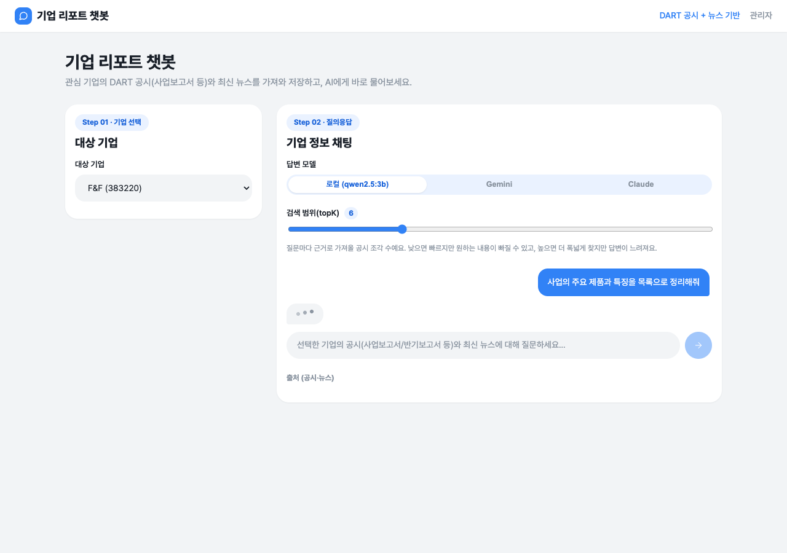
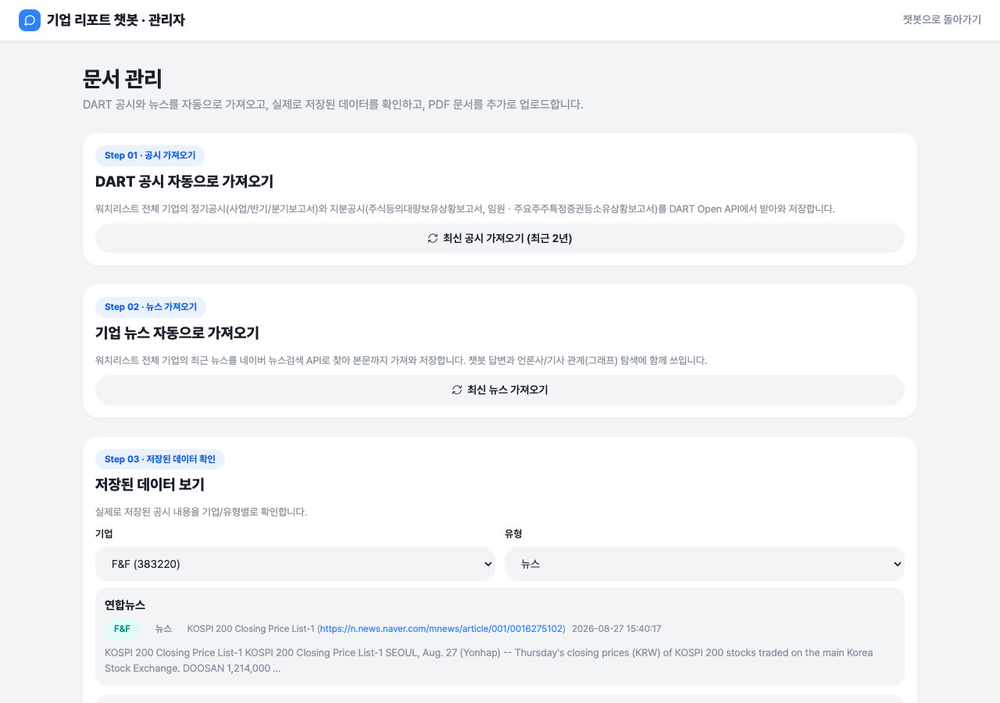
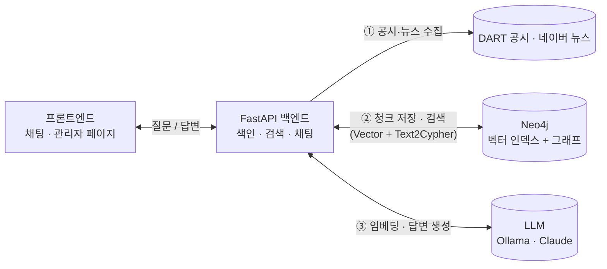
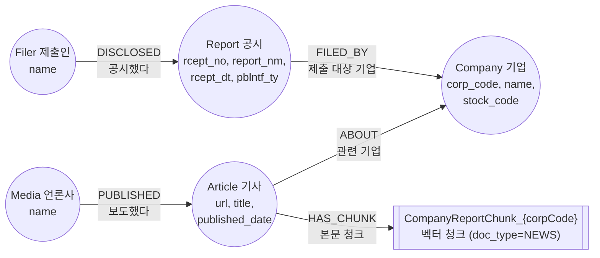

# 기업 리포트 챗봇(RAG)

[기업 공시 챗봇 개선 이력 · 도구 호출과 평가](docs/2026-11-26-기업-공시-챗봇-도구-호출과-평가-개선-이력.md)

[프로젝트 구조 다이어그램 · MCP, Function Calling, DB, 외부 통신](docs/architecture.md)

DART 전자공시(사업/반기/분기보고서 + 지분공시)와 관련 뉴스를 근거로 관심 기업에
답변하는 RAG 챗봇입니다. 공시는 DART API, 뉴스는 네이버 검색결과 페이지(API 키
불필요)에서 가져와 기업별 Neo4j 벡터 인덱스에 함께 저장합니다. 지분공시 제출인과
뉴스 기사 관계는 그래프로도 저장해서, 벡터 검색(Vector Retriever)만으로 안 되는
집계·랭킹 질문은 LLM이 만든 읽기 전용 Cypher(Text2Cypher)로 조회합니다.
채팅에서 로컬(Ollama), Claude, DeepSeek 모델과 고정 RAG·Tool Calling 경로를 선택할 수 있습니다.
Eval CLI로 같은 정답셋을 실행해 검색 근거, 답변 정확도, 토큰 사용량을 비교합니다.

## 사용 화면


기업을 고르고 질문하면 답변과 함께 근거 공시(회사명/보고서명/접수번호/섹션)를
보여줍니다. 답변 모델(로컬/Claude)과 검색 범위(topK)를 조절할 수 있고,
표/목록이 포함된 답변은 마크다운으로 렌더링됩니다.



답변 생성 중에는 타이핑 인디케이터(점 3개)가 표시됩니다.


관리자 페이지(`/admin.html`)에서 공시를 한 번에 가져오고, Neo4j에 저장된 청크를
기업/유형별로 확인할 수 있습니다. PDF 업로드와 지분공시 그래프 탐색도 여기서.


뉴스 질문("F&F 디스커버리 관련 뉴스 3개만 알려줘")을 하면 실제 뉴스 기사가
근거로 잡히고, 출처에 "뉴스" 태그와 원문 링크가 함께 표시됩니다.



유형을 "뉴스"로 필터링하면 색인된 기사 목록을 확인하고, URL을 클릭해 원문으로
바로 이동할 수 있습니다.

## 아키텍처



- **① 공시·뉴스 수집**: DART 공시(XML)는 목차 단위로 분해, 뉴스는 네이버 검색결과·
  기사 페이지를 파싱(API 키 불필요)해서 본문을 가져옵니다. 둘 다 청킹 후 같은 기업
  전용 Neo4j 인덱스에 저장되고(뉴스는 `doc_type=NEWS`로 구분), 지분공시 제출인/뉴스
  기사-언론사 관계는 그래프로도 함께 기록됩니다. 변경 없는 공시·이미 수집한 기사
  URL은 재수집하지 않습니다.
- **② 검색**: 질문을 임베딩해 기업 전용 인덱스에서 유사도 검색(Vector Retriever,
  뉴스 키워드면 `doc_type=NEWS`로 필터). 집계·랭킹처럼 벡터 검색만으로 안 되는
  그래프 질문이면 LLM이 즉석에서 Cypher를 생성해 실행(Text2Cypher), 실패하면 고정
  조회로 폴백합니다.
- **③ 답변**: 대화 히스토리가 있으면 먼저 후속 질문을 독립형으로 재작성한 뒤, 위
  검색 결과를 근거로 로컬(Ollama)/Claude 중 선택한 모델이 답변을 생성합니다.

## 그래프 DB 스키마

지분공시 제출인 관계와 뉴스 기사 관계를 하나의 Neo4j 그래프로 구성합니다(참고:
[graphrag-tools-retriever](https://github.com/gongwon-nayeon/graphrag-tools-retriever)의 뉴스 그래프 스키마 구조를 참고해
`Company` 노드를 공시 그래프와 뉴스 그래프가 공유하도록 확장했습니다).



- **Company (기업)**: 워치리스트 기업 (`corp_code`가 유일키) — 지분공시 그래프와 뉴스
  그래프가 공유하는 중심 노드
- **Report (공시)**: DART 공시 1건 (`rcept_no`가 유일키), `Company`에 `FILED_BY`(제출
  대상 기업)로 연결
- **Filer (제출인)**: 지분공시 제출인, `Report`에 `DISCLOSED`(공시했다)로 연결
  (대량보유상황보고서/임원·주요주주소유보고서에서만 생성)
- **Article (기사)**: 뉴스 기사 1건 (`url`이 유일키), `Company`에 `ABOUT`(관련 기업)으로
  연결, 실제 본문이 담긴 벡터 청크 노드에 `HAS_CHUNK`(본문 청크)로 연결
- **Media (언론사)**: 언론사, `Article`에 `PUBLISHED`(보도했다)로 연결

이 스키마는 Text2Cypher 라우터 프롬프트에 그대로 포함되어 LLM이 보고 Cypher를 생성합니다.

## 그래프 생성 과정

그래프는 답변 시점이 아니라 **공시·뉴스를 색인할 때** Neo4j에 기록합니다. 관계의
원천은 DART 목록과 수집한 뉴스의 메타데이터입니다. 공시·기사 본문 전체에서 LLM으로
개체와 관계를 추출해 지식 그래프를 만드는 방식은 아닙니다.

1. **공시** — [`company_report_index.py`](app/services/company_report_index.py)의
   `CompanyReportIndexService._index_disclosure()`가 DART 목록의 공시마다
   [`disclosure_graph.py`](app/services/disclosure_graph.py)의 `DisclosureGraphService.record_disclosure()`를
   호출합니다. `corp_code`로 `Company`, `rcept_no`로 `Report`를 `MERGE`하고
   `Report-[:FILED_BY]->Company`를 연결합니다. 지분공시(`pblntf_ty=D`)는 목록의
   `flr_nm`(제출인)이 비어 있지 않고 대상 기업명과 다를 때 `Filer`를 만들고
   `Filer-[:DISCLOSED]->Report`를 연결합니다. 공시 XML 본문은 별도로 섹션 분리·청킹해
   기업별 벡터 인덱스에 저장하며, 공시 청크와 `Report` 사이에 직접 관계를 만들지는
   않습니다. 검색 시 청크의 `rcept_no` 메타데이터로 해당 `Report`를 찾습니다.
2. **뉴스** — [`news_ingest.py`](app/services/news_ingest.py)의
   `NewsIngestService._ingest_article()`가 기사 본문을 청킹해 기업별 벡터 인덱스에 저장한 뒤,
   [`news_graph.py`](app/services/news_graph.py)의 `NewsGraphService.record_article()`을
   호출합니다. 기사 URL로 `Article`, 검색 대상 기업의 `corp_code`로 `Company`를
   `MERGE`해 `Article-[:ABOUT]->Company`로 연결합니다. 언론사 정보가 있으면
   `Media-[:PUBLISHED]->Article`을 만들고, 저장된 뉴스 청크 ID로
   `Article-[:HAS_CHUNK]->청크`를 연결합니다. 본문에서 언급된 다른 기업을 자동
   추출해 `ABOUT` 관계를 추가하지는 않습니다.

## 검색 전략: Vector Retriever + Text2Cypher

[graphrag-tools-retriever](https://github.com/gongwon-nayeon/graphrag-tools-retriever)의
`ToolsRetriever`(검색 방식을 통합하는 구조)에서 아이디어를 가져왔습니다. 매 질문마다
벡터 검색을 수행하고, 그래프 조회는 Text2Cypher를 시도한 뒤 필요하면 검색된 청크에
연결된 관계를 고정 Cypher로 확장합니다.

1. **Vector Retriever** — 질문을 임베딩해 기업 전용 인덱스에서 유사도 상위 topK개
   청크 조회. "뉴스/기사" 키워드가 있으면 `doc_type='NEWS'` 필터를 추가로 걸되, Neo4j
   필터가 ANN 검색 이후 적용되는 post-filter라 후보군을 넉넉히(200개) 가져온 뒤 잘라
   씁니다(안 그러면 후보에 뉴스가 하나도 안 걸려 0건이 될 수 있음).
2. **Text2Cypher** — 집계·랭킹처럼 벡터 검색만으로 안 되는 그래프 질문이면 LLM이
   스키마를 보고 Cypher를 생성해 읽기 전용으로 실행. 쓰기 구문은 정규식으로 차단하고,
   쿼리를 생성하지 않거나 실행 실패·결과 없음이면 검색된 지분공시 청크의 `rcept_no`와
   뉴스 청크의 `article_url`을 기준으로 고정 Cypher 관계 확장
   (`expand_retrieved_context`)을 수행합니다. 해당 청크가 없으면 그래프 확장을 건너뜁니다.

## 기술 스택

- **Backend**: Python 3.11+, FastAPI + Uvicorn, Pydantic Settings(`.env` 설정)
- **LLM/임베딩**: Ollama (`qwen2.5:3b` 채팅, `bge-m3` 임베딩) 기본, 선택적으로
  Claude(로그인된
  `claude -p` CLI를 서브프로세스로 호출 — API 키 없이 claude.ai 구독 계정 그대로 사용)
- **벡터스토어**: Neo4j 공식 Python 드라이버로 직접 구현(기업마다 별도 라벨/인덱스로
  분리), 지분공시·뉴스 그래프도 같은 Neo4j에 저장. 청킹은 `tiktoken` 토큰 기준
- **문서 파싱**: 공시 XML은 `lxml`, PDF는 `pypdf`
- **뉴스 수집**: `httpx` + BeautifulSoup으로 네이버 뉴스 검색결과/기사 페이지를 직접
  파싱 (Selenium·공식 API 키 불필요)
- **외부 API**: DART(전자공시시스템) Open API
- **Frontend**: Vue 3 + TypeScript + Vite, 대화 히스토리는 브라우저 IndexedDB에 저장.
  답변은 `marked`로 마크다운 파싱 후 `DOMPurify`로 sanitize해 렌더링. 빌드 결과는
  `static/`에 커밋되어 있어 Node 없이도 바로 실행됩니다.

## 실행 방법

### 1) 사전 준비

**Python 3.11 이상**과 가상환경:

```bash
python3 -m venv .venv
source .venv/bin/activate
pip install -e ".[dev]"
```

**Ollama** (로컬에서 실행 중이어야 함):

```bash
ollama serve
ollama pull qwen2.5:3b
ollama pull bge-m3
```

**Neo4j** (Docker 예시, 벡터 인덱스를 지원하는 5.x 이상):

```bash
docker volume create company-report-neo4j-data
docker volume create company-report-neo4j-logs

docker run -d --name company-report-neo4j \
  --restart unless-stopped \
  --tmpfs /var/lib/neo4j/run \
  -p 7474:7474 -p 7687:7687 \
  -e NEO4J_AUTH=neo4j/companyreport \
  -v company-report-neo4j-data:/data \
  -v company-report-neo4j-logs:/logs \
  neo4j:5.15
```

`-v`로 이름 있는 볼륨을 지정해야 `docker rm`으로 컨테이너를 지웠다가 같은 명령으로
다시 만들어도 색인된 데이터가 그대로 유지됩니다(볼륨을 안 붙이면 컨테이너 삭제 시
데이터도 함께 사라집니다). `--tmpfs /var/lib/neo4j/run`이 없으면 컨테이너를 멈췄다
다시 켤 때 "Neo4j is already running (pid:7)"가 나며 기동에 실패합니다.

**환경변수(`.env`)**: 설정은 [app/config.py](app/config.py)에 기본값이 있고, 프로젝트
루트의 `.env` 파일이나 환경변수로 덮어씁니다. `.env`는 `.gitignore`에 포함되어 있어
커밋되지 않습니다.

```bash
cp .env.example .env
```

- `DART_API_KEY` (필수): [DART Open API](https://opendart.fss.or.kr)에서 발급
- `NEO4J_URI` / `NEO4J_USERNAME` / `NEO4J_PASSWORD`, `OLLAMA_BASE_URL` /
  `OLLAMA_CHAT_MODEL` / `OLLAMA_EMBEDDING_MODEL`: 기본값과 다를 때만 수정

**Claude CLI (선택)**: 채팅에서 "Claude" 모델을 쓰려면 이 머신에 [Claude
Code CLI](https://claude.com/claude-code)가 설치되어 있고 `claude` 명령이
PATH에 잡혀 있어야 하며, `claude login`으로 claude.ai 계정에 로그인되어 있어야
합니다. 백엔드가 API 키 없이 `claude -p` 서브프로세스를 그대로 호출하는 방식이라
별도 키 설정은 필요 없습니다. CLI가 없거나 로그인이 안 되어 있으면 Claude 옵션
선택 시 에러가 납니다.

### 2) 실행

```bash
source .venv/bin/activate
uvicorn app.main:app --port 8080
```

`http://localhost:8080`에서 앱 전체(백엔드 + `static/`의 프론트엔드)가 뜹니다.
관리자 페이지는 `http://localhost:8080/admin.html`, API 문서(Swagger UI)는
`http://localhost:8080/docs`. 8080이 이미 쓰이고 있으면 `--port`만 바꾸면 됩니다.
코드를 고치면서 띄우려면 `--reload`를 붙입니다.

테스트:

```bash
pytest
```

`static/`은 원 프로젝트([rag-company-report](https://github.com/Daniel0915/rag-company-report))의
`frontend/`(Vue)를 빌드한 결과물을 그대로 가져온 것이라, 이 저장소에는 프론트엔드
소스가 없습니다. 프론트엔드를 수정하려면 원 프로젝트에서 빌드한 뒤 결과물을
`static/`에 덮어씁니다:

```bash
cd ../rag-company-report/frontend
npm install
npm run build   # 결과물이 src/main/resources/static 으로 출력됨
rm -rf ../../rag-company-report-py/static
cp -r ../src/main/resources/static ../../rag-company-report-py/static
```

### 3) 사용 순서

1. 기업 선택 후 "최신 공시 가져오기"로 최근 2년치 공시(정기공시 + 지분공시) 색인
2. 관리자 페이지(`/admin.html`)에서 "최신 뉴스 가져오기"로 워치리스트 기업의 최신
   뉴스도 함께 색인 (`POST /api/admin/news/fetch`)
3. 채팅창 상단에서 답변 모델(로컬/Claude)과 검색 범위(topK) 선택
4. 궁금한 내용 질문 (예: "사업의 개요 알려줘", "최근 관련 뉴스 알려줘") — 이전 대화가
   있으면 자동으로 참고됨
5. 답변 하단의 "출처 (공시·뉴스)"에서 근거가 된 보고서/기사 확인 — 뉴스는 "뉴스" 태그와
   함께 원문 링크가 표시됨
6. 관리자 페이지에서 PDF 직접 업로드, 색인된 청크 조회(유형을 "뉴스"로 필터링하면
   기사 목록만 확인 가능), 지분공시 제출인/관련기업 그래프 탐색 가능

화면 대신 API로 바로 호출하려면 `http://localhost:8080/docs`에서 각 엔드포인트를
실행해 볼 수 있습니다.

### 4) 공시 수집 (전체 유형 + 주간 배치)

공시는 DART 전체 유형(A~J)을 수집합니다. 수집은 `python -m app.ingest` CLI가 맡고,
매주 토요일 07:10에 macOS launchd가 `update`를 자동 실행합니다. 실패하거나 일부만
성공하면 macOS 배너 알림과 함께 오류 내용이 담긴 알림창이 뜨고, 정상 종료 때는 알림이 없습니다.
알림창의 "오류 로그 열기"를 누르면 그날의 `logs/ingest/YYYY-MM-DD.errors.log`(경고 이상만
모은 로그)가 열립니다. DART API 키는 로그와 알림에서 `***`로 가려집니다.

**처음 실행 순서**

```bash
source .venv/bin/activate

# 1. 기존 Spring 프로젝트의 색인 장부를 가져옵니다(이미 색인한 공시를 건너뛰기 위함)
python -m app.ingest import-ledger ../rag-company-report/data/company-report-index.json

# 2. 전체 기간 backfill. M1 기준 약 8시간 걸리니 밤사이에 돌리고,
#    잠자기 모드로 멈추지 않게 caffeinate를 씁니다.
caffeinate -i python -m app.ingest backfill

# 3. 결과 확인
python -m app.ingest status

# 4. 주간 수집 등록 (매주 토요일 07:10)
scripts/launchd/install.sh
```

첫 전체 backfill을 끝낸 뒤에 UI의 "최신 공시 가져오기"를 누르거나 launchd를 설치하세요.
옵션 없는 `backfill`만 마지막 성공일을 기록해, 이후 갱신이 2년치를 다시 훑지 않습니다.

`backfill`은 `--since YYYY-MM-DD`, `--corp CODE [CODE ...]`(공백으로 여러 개), `--types A,B,...`로
범위를 좁힐 수 있습니다. 등록을 풀려면 `scripts/launchd/uninstall.sh`, 설치될 plist만
미리 보려면 `scripts/launchd/install.sh --dry-run`.

**자동 실행 전제 조건**: Mac이 잠자고 있었으면 깨어난 뒤 실행되고, 꺼져 있었으면
다음 주 실행 때 조회 기간이 넓어져 메워집니다. 다만 수집이 돌려면 아래가 떠 있어야
하므로 Docker Desktop과 Ollama를 로그인할 때 자동 실행되도록 설정하고, Neo4j
컨테이너도 Docker와 함께 켜지게 합니다. 위 `docker run`에 `--restart unless-stopped`와
`--tmpfs /var/lib/neo4j/run`이 들어 있어야 하는데, 예전 명령으로 만든 컨테이너라면
다시 만듭니다. `docker update`로는 tmpfs 마운트를 추가할 수 없습니다. 이름 있는
볼륨에 데이터가 있어 지워도 색인은 유지됩니다.

```bash
docker stop company-report-neo4j && docker rm company-report-neo4j
# 위 Neo4j `docker run` 명령을 다시 실행
```

기존 컨테이너로는 멈췄다 켠 뒤 "Neo4j is already running (pid:7)"가 나면서 기동에
실패할 수 있습니다.

**로그와 상태**

- 실행 로그: `logs/ingest/YYYY-MM-DD.log` (30일 보관), launchd 출력은 `logs/ingest/launchd.log`
- 상태 파일: `data/ingest-state.json`, 실행 잠금: `data/ingest.lock`, 색인 장부: `data/company-report-index.json`
- 현재 상태(마지막 실행 시각, 마지막 성공일, 재시도 대기 건수, 재시도 중단 목록): `python -m app.ingest status`

### 5) 답변 평가

정답셋으로 검색과 답변의 품질을 재고, 설정이나 프롬프트를 바꾼 전후를 비교합니다.
`python -m app.eval` CLI를 쓰며 FastAPI 서버는 필요 없습니다.
[RAG 품질 개선 이력](docs/rag-quality-history.md)에서 변경 시각과 평가 결과를 확인할 수 있습니다.

**필요 조건**: Neo4j와 Ollama가 켜져 있어야 하고, 문항 생성과 `--judge claude`에는
로그인된 `claude` CLI가 필요합니다. API 키는 쓰지 않습니다.

```bash
source .venv/bin/activate

# 1. 후보 문항 생성 (기본 30문항). 결과는 eval/candidates.yaml에 추가됩니다.
python -m app.eval generate --corp 00126380

# 2. VS Code에서 eval/candidates.yaml을 검수합니다.
#    문항을 고치고, 쓸 문항은 review: ok, 버릴 문항은 review: drop으로 바꿉니다.

# 3. 검수한 문항을 정답셋(eval/dataset.yaml)으로 옮깁니다. drop은 버립니다.
python -m app.eval accept

# 4. 평가 실행 (provider: local | deepseek | claude)
python -m app.eval run --provider local --top-k 6
python -m app.eval run --provider deepseek --judge claude   # 채점은 claude CLI(기본 opus)
python -m app.eval run --provider claude --claude-model haiku --judge claude

# 5. 두 실행 비교
python -m app.eval compare eval/runs/A.json eval/runs/B.json
```

**문항 생성**: 유형별 기본 할당은 정기공시 A 12, 거래소공시 I 8, 주요사항 B 5, 지분공시 D 3,
기타 J 1·E 1입니다. `--quota A=6,I=4`처럼 쓰면 지정한 유형만 그 개수로 뽑습니다.
`--seed`로 무작위 선택을 재현할 수 있습니다. 워치리스트에 있는 기업만 지정할 수 있고,
이미 정답셋이나 후보에 있는 섹션은 피해서 뽑습니다.

**답이 없는 질문**은 자동으로 만들 수 없어 `eval/dataset.yaml`에 직접 씁니다. 5~10개를
권장합니다. `corp_code`는 반드시 따옴표로 감쌉니다. 따옴표가 없으면 숫자로 읽혀
앞의 0이 사라지므로 거부됩니다.

```yaml
- id: m0001
  corp_code: "00126380"
  question: 삼성전자의 2030년 예상 배당금은?
  answerable: false
  origin: manual
```

**기대 도구(`expected_tools`)**는 에이전트 평가용 선택 필드입니다. 문항을 풀 때 쓰면 맞는
도구 이름을 목록으로 적으며, 이 중 하나라도 쓰면 `tool_selection`이 1이 됩니다. 비워 두면 그
문항은 `tool_selection`, `unnecessary_web` 집계에서 빠지고, 고정 경로 평가에서는 쓰지 않습니다.
도구 이름은 아래 에이전트 모드의 도구 6개와 외부 MCP 도구 목록에서 골라야 하며, 다른 이름이면
정답셋을 읽을 때 거부됩니다. 근거가 공시 원문에 없는 문항(주가, DART가 계산한 재무지표 등)은
`expected_tools`를 적으면 `expected_sections`를 비울 수 있고, 이런 문항은 검색 지표(`hit_*`, `mrr`)에서 빠집니다.

```yaml
- id: m0002
  corp_code: "00126380"
  question: 삼성전자 2024년 영업이익은?
  answerable: true
  expected_tools: [get_financials]
  # expected_answer, must_include, expected_sections 등은 기존과 같습니다
```

**실행 옵션**: `--provider`는 `local`(기본), `claude`입니다. `--corp CODE`는 그 기업의
문항만 돌립니다. Ollama는 결과가 흔들리지 않도록 기본으로 temperature 0, seed 42로 호출하며
`--temperature`, `--seed`로 바꿀 수 있습니다. 쓴 값은 결과 파일에 남고, 채팅 API의 호출에는
영향이 없습니다. Claude는 seed를 고정할 수 없어 비교 결과가 조금 흔들립니다.
`--judge claude`는 Claude가 답변의 근거 충실도와 정확성을 추가로 채점하는 옵션입니다(기본은
규칙 채점만). 답변 provider도 `claude`이면 자기 답을 자기가 채점한다는 경고가 나옵니다.

**결과**: `eval/runs/<시각>_<provider>_k<topK>.json`에 저장되며 git에 올라가지 않습니다.
터미널 요약표에는 지표별 값과 대상 문항 수가 전체와 공시 유형별로 나옵니다.
`compare`는 지표 변화와 좋아지거나 나빠진 문항을 보여 주고, 두 실행의 정답셋이나 인덱스
상태가 다르면 경고합니다. 지표표에는 실행별 분모(`n_A`, `n_B`)와, 값이 달라진 지표의
좋아짐/나빠짐 표시가 붙습니다(`false_refusal`, `unsupported_numbers`는 낮을수록 좋고,
`prompt_tokens`는 컨텍스트를 일부러 늘렸을 수 있어 표시하지 않습니다). 분모가 다르면 같은
문항에 대한 비교가 아닐 수 있으니 확인하세요. `--judge claude`로 채점이 실패한 문항이 있으면
실행 끝에 `채점 실패 N건`과 첫 오류가 출력됩니다.

`generate`는 문항을 하나 만들 때마다 `eval/candidates.yaml`을 다시 쓰므로, 실행 중에는
VS Code로 그 파일을 편집하지 마세요. `accept`와 `generate`는 파일을 새로 쓰기 때문에
YAML 주석은 보존되지 않습니다.

| 지표 | 뜻 |
|---|---|
| `hit_strict` / `hit_loose` | 상위 k개(`--top-k`) 검색 결과에 기대한 공시 섹션이 있는 비율(hit@k). loose는 같은 제목의 다른 보고서 섹션도 인정 |
| `mrr` | 기대한 섹션이 검색 결과 앞쪽에 나올수록 높은 점수 |
| `fact_recall` | 핵심 사실(숫자 등)이 답변에 들어 있는 비율 |
| `false_refusal` | 답이 있는데 "모른다"고 한 비율. 낮을수록 좋음 |
| `correct_refusal` | 답이 없는 질문에 "모른다"고 한 비율. 높을수록 좋음 |
| `unsupported_numbers` | 문항당 평균. 답변 속 숫자 중 모델이 본 근거(본문과 출처 머리말)와 질문에 없는 숫자의 수(지어낸 숫자 신호). 낮을수록 좋음 |
| `prompt_tokens` | 문항당 평균. Ollama가 실제로 읽은 입력 토큰 수(local만) |
| `usage`(문항별) | 답을 만드는 동안 쓴 외부 LLM(claude, deepseek)의 호출 수, 입력/출력 토큰, 비용(USD). 채점 호출은 뺀다. claude CLI 비용은 API 단가로 계산한 참고값이다 |
| `faithfulness` | `--judge claude`일 때. 답변의 사실 주장 중 근거로 뒷받침되는 비율(0~1) |
| `judge_correct` | `--judge claude`일 때. 답변이 기대 답과 일치하는(답 없는 질문은 적절히 거절한) 문항의 비율 |
| `tool_selection` | 에이전트 평가에서 `expected_tools`가 있는 문항 중, 기대한 도구를 하나라도 쓴 비율. 높을수록 좋음 |
| `unnecessary_web` | 에이전트 평가에서 `expected_tools`가 있는 문항 중, `web_search`가 기대 목록에 없는데 쓴 비율. 낮을수록 좋음 |
| `tool_errors` | 에이전트 평가에서 문항당 평균 실패한 도구 호출 수(`ok=false`). 낮을수록 좋음 |
| `tool_calls` | 에이전트 평가에서 문항당 평균 도구 호출 수. 좋고 나쁨의 방향은 매기지 않음 |

## 에이전트 모드

기본 채팅은 검색 방식이 고정되어 있습니다(Vector Retriever, 필요하면 Text2Cypher). 에이전트
모드는 모델이 질문에 맞는 도구를 직접 골라 여러 번 부르고, 그 결과를 근거로 답합니다.
요청에 `"agent": true`를 넣을 때만 켜지며, 넣지 않으면 응답 JSON은 이전과 완전히 같습니다
(`answer`, `sources`만).

### 도구 6개

| 도구 | 하는 일 |
|---|---|
| `search_disclosures` | 공시 원문·뉴스 청크 벡터 검색. `doc_type=NEWS`면 뉴스만 |
| `get_financials` | DART 주요계정(매출액, 영업이익, 당기순이익 등) 조회. `year`, `report`(annual/half/q1/q3) 필수 |
| `list_recent_disclosures` | 최근 공시 목록. `since`, 유형(A~J), `limit` 필터 |
| `query_ownership_graph` | 지분공시 그래프에 읽기 전용 Cypher 실행(쓰기 구문은 거부, 결과 최대 200행, 실행 10초 제한) |
| `calculate` | 사칙연산과 괄호만 계산(증감률 등) |
| `web_search` | Tavily 웹검색. 공시·뉴스에 없는 정보에만 쓰도록 프롬프트로 안내 |

도구는 `app/agent/tools.py`에 한 번만 정의되고, 로컬 모델과 Claude가 같은 정의를 씁니다.
워치리스트 밖 `corp_code`, 빈 결과, 외부 API 오류는 예외 대신 실패 결과(`ok=false`)나
"결과 없음"으로 모델에 돌려줍니다.

### 외부 MCP 도구

에이전트는 남이 만든 MCP 서버 두 개의 도구 일부를 위 6개와 함께 씁니다. 우리 앱이 MCP
클라이언트가 되어 요청마다 서버를 띄우고(`app/agent/mcp_pool.py`), 고른 도구만 같은 도구 목록에
붙입니다(`app/agent/external_mcp.py`). 기본으로 켜져 있고, `.env`에 `AGENT_EXTERNAL_MCP=false`를
넣으면 끕니다. 2026-11-27 DeepSeek 에이전트 평가(64문항)에서 켠 쪽이 기존 52문항 정답 29→33,
새 도구 문항 12개 정답 10→12로 나아져 기본값을 켬으로 바꿨습니다.

| 도구 | 외부 서버 · 원격 도구 | 하는 일 |
|---|---|---|
| `dart_largest_shareholder` | `opendart-mcp` · `get_largest_shareholder` | 최대주주와 특수관계인 지분. `year`, `report` |
| `dart_dividend` | `opendart-mcp` · `get_dividend_info` | 주당 배당금, 배당성향, 배당수익률 |
| `dart_executives` | `opendart-mcp` · `get_executive_status` | 임원 현황 |
| `dart_financial_index` | `opendart-mcp` · `get_single_financial_index` | 수익성·안정성·성장성·활동성 지표(ROE, 부채비율 등). `category` |
| `krx_stock_price` | `pykrx-mcp` · `get_stock_ohlcv` | 일별 시가·고가·저가·종가·거래량(수정주가). 기간은 최대 31일 |
| `krx_market_cap` | `pykrx-mcp` · `get_market_cap_by_date` | 일별 시가총액(원)과 상장주식수. KRX 로그인 필요, 최대 31일 |
| `krx_market_fundamentals` | `pykrx-mcp` · `get_market_fundamental_by_date` | 일별 PER·PBR·EPS·BPS·배당수익률. KRX 로그인 필요, 최대 31일 |

- **실행 방식:** 두 서버는 MCP SDK 1.x로 짜여 있어 이 저장소(2.x)와 섞지 않고
  `uvx --with "mcp<2" opendart-mcp@0.1.0`, `uvx --with "mcp<2" pykrx-mcp@0.1.3`으로 따로 띄웁니다.
  `uv`가 설치되어 있어야 합니다. 처음 실행할 때 패키지를 내려받는데, 이 시간이 시작 시간 제한(30초)에
  걸리면 첫 요청의 외부 도구가 실패합니다. 켜기 전에 아래 명령으로 한 번 미리 받아 두세요.

  ```bash
  uvx --with "mcp<2" opendart-mcp@0.1.0 --help
  uvx --with "mcp<2" pykrx-mcp@0.1.3 --help
  ```
- **회사 범위:** `corp_code`와 종목코드는 모델에게 보이지 않고 현재 대화 중인 회사로 넣습니다.
- **인증:** DART 키는 `opendart-mcp`에 넘깁니다. 시가총액과 투자지표 도구는 로컬 `.env`의
  `KRX_ID`와 `KRX_PW`를 모두 설정하면 활성화됩니다. 이 계정은 해당 두 도구를 실행하는 `pykrx-mcp`
  프로세스에 전달합니다. 결과·오류의 인증값은 가리고, 인증값이 포함된 서버 stderr는 폐기합니다.
- **실패:** 서버가 안 뜨거나 `AGENT_EXTERNAL_MCP_TIMEOUT_SECONDS`(기본 30초) 안에 답하지 않으면
  그 호출만 실패 결과가 되고, 모델은 다른 도구로 계속 답합니다.
- **출처:** `sources`에 `docType`이 `"DART_API"`(접수번호 포함) 또는 `"KRX"`인 항목으로 들어갑니다.
- **주가 데이터:** 일별 수정주가는 pykrx의 네이버 금융 경로에서 조회하며 KRX 계정 없이 사용할 수 있습니다.
- **확인:** `RUN_EXTERNAL_MCP=1 pytest tests/test_external_mcp_live.py`가 실제 서버의 도구 목록과
  스키마와 삼성전자 응답을 확인합니다. KRX 계정 설정이 있으면 시가총액과 PER·PBR 응답도 확인합니다.

### 요청 예시

```bash
curl -X POST http://localhost:8080/api/company-report/chat \
  -H 'Content-Type: application/json' \
  -d '{"question": "삼성전자 2024년 영업이익은?", "corpCode": "00126380", "provider": "local", "agent": true}'
```

응답에는 `answer`, `sources`에 더해 `toolCalls`(`name`, `arguments`, `ok`, `summary`)가
호출 순서대로 들어갑니다. `summary`는 도구 결과 앞 200자입니다. 웹검색 결과는 `sources`에
`docType`이 `"WEB"`인 항목으로 들어가며, 이때 `reportNm`은 페이지 제목, `rceptNo`는 URL입니다.
`history`가 있으면 후속 질문을 독립형 질문으로 재작성한 뒤 에이전트에 넘깁니다.
`corpCode`가 비면 400, 에이전트 실행이 실패하면(모델/CLI 오류, 시간 초과 등) HTTP 502와
`"에이전트 실행 실패"`를 돌려줍니다. 에이전트 모드에서는 `topK`를 쓰지 않으며 값을 줘도
무시됩니다(검색 청크 수는 모델이 도구 인자로 정합니다).

채팅 화면에서는 "답변 모델"(로컬, Claude, DeepSeek)과 "답변 방식"(기본, 에이전트)을
고릅니다. 에이전트를 고르면 요청에 `agent: true`가 실립니다. 화면은 빌드된 파일
(`static/assets`)을 직접 고친 것이라, 프런트 원본 저장소에도 같은 변경을 옮겨야 합니다.

### provider별 차이

| | 로컬(`provider: local`) | DeepSeek(`provider: deepseek`) | Claude(`provider: claude`) |
|---|---|---|---|
| 호출 방식 | Ollama | DeepSeek 공식 API(OpenAI 호환, `openai` 라이브러리) | 로그인된 `claude` CLI(구독) |
| 도구 호출 | Ollama Function Calling을 서버 안의 루프가 돌림 | 같은 루프를 OpenAI 방식 function calling으로 돌림 | CLI에 MCP stdio 서버(`app/agent/mcp_server.py`)를 붙여 CLI가 호출 |
| 설정 | 컨텍스트 `AGENT_OLLAMA_NUM_CTX`(기본 16384) | `DEEPSEEK_API_KEY`, 모델 `DEEPSEEK_MODEL`(기본 `deepseek-flash`), 주소 `DEEPSEEK_BASE_URL`(기본 `https://api.deepseek.com`) | 타임아웃 `AGENT_CLAUDE_TIMEOUT_SECONDS`(기본 180초) |
| 기록 | 실행기가 메모리에 기록 | 실행기가 메모리에 기록 | MCP 서버가 임시 파일에 JSON Lines로 남기고 끝난 뒤 읽음 |

DeepSeek는 선불 크레딧을 쓰는 API입니다. `.env`의 `DEEPSEEK_API_KEY=` 뒤에 키를
넣으세요. DeepSeek 공식 API는 응답에 비용을 주지 않으므로 평가 결과의 `cost_usd`는 0입니다.
실제 사용액은 DeepSeek 콘솔의 잔액으로 확인합니다. OpenRouter 같은 다른 OpenAI 호환 API를
쓰려면 `DEEPSEEK_BASE_URL`, `DEEPSEEK_MODEL`, `DEEPSEEK_API_KEY`를 그 서비스 값으로 바꿉니다. 키가 비어 있으면 앱은 뜨고, `deepseek`를 고른 요청만 실패합니다. 고정 경로
(`agent` 없이)에서도 `provider: deepseek`로 답변할 수 있습니다.

Claude 경로는 `--strict-mcp-config`로 우리 MCP 도구 6개만 허용하고 CLI 내장 도구(웹검색
포함)는 막습니다. 고정 경로와 에이전트 경로 모두 `--setting-sources ""`로 사용자 설정
(전역 CLAUDE.md, 훅, 플러그인)을 읽지 않습니다. API 키는 쓰지 않으며 CLI 호출 환경에서도
`ANTHROPIC_API_KEY` 등을 제거합니다.

### 웹검색 설정

`web_search`는 Tavily 키가 필요합니다. 프로젝트 루트 `.env`의 `TAVILY_API_KEY=` 뒤에
본인 키를 넣으세요(`.env.example`에는 빈 값만 있습니다). 키를 저장소, 로그, 결과 파일에
남기지 마세요. 키가 비어 있으면 `web_search`는 실패 결과를 돌려주고 나머지 도구는
그대로 동작합니다.

### 호출 한도와 반복 차단

질문 하나에 도구는 최대 6회(`AGENT_MAX_TOOL_CALLS`)까지 실행됩니다. 한도를 넘은 호출은
실행하지 않고 오류 결과를 돌려 "지금까지의 근거로 답하라"고 알립니다. 같은 도구를 같은
인자로 다시 부르면 마찬가지로 실행하지 않고 오류 결과를 돌려줍니다. 스키마에 맞지 않는
인자도 실행 전에 오류 결과로 거절합니다. 로컬 경로는 한도 뒤에도 모델이 도구만 부르면
도구 없이 최종 답변을 한 번 더 요청합니다.

### 에이전트 평가

```bash
python -m app.eval run --provider local --agent
python -m app.eval compare eval/runs/A.json eval/runs/B.json
```

`--agent`는 고정 경로 대신 에이전트 경로로 정답셋을 돌립니다(`--top-k`는 쓰지 않음).
`--external-mcp`를 더하면 외부 MCP 도구를 붙여 돌리고, 결과 파일 이름 끝에 `_ext`가 붙습니다.
`--corp`, `--judge`, `--temperature`, `--seed`, `--provider`는 그대로 쓸 수 있고, 결과
파일 이름 끝에 `_agent`가 붙으며 문항마다 `tool_calls`(seq, name, arguments, ok)가 기록됩니다.
검색 지표(`hit_*`, `mrr`)는 `search_disclosures`가 돌려준 청크로 셉니다. 검색을 여러 번 하면
청크 목록을 이어 붙여 `mrr`을 계산하므로 고정 경로의 단일 top-k 목록과 엄밀히 같은 기준이
아닙니다(`hit_strict`/`hit_loose`는 비교할 수 있습니다). `--judge`의 근거는 `search_disclosures`
청크뿐 아니라 모든 도구 결과 텍스트입니다. 새 지표는 위
답변 평가 절의 표(`tool_selection`, `unnecessary_web`, `tool_errors`, `tool_calls`)를 보세요.

## API 엔드포인트

| Method | Path | 설명 |
|---|---|---|
| GET | `/api/company-report/watchlist` | 워치리스트 기업 목록 조회 |
| POST | `/api/company-report/index?bgn_de=&end_de=` | 워치리스트 기업의 공시 색인. 날짜를 모두 생략하면 `update`와 같이 마지막 성공 실행 이후 새 공시(7일 겹침)만 수집하고, `bgn_de`와 `end_de`를 둘 다 주면 그 기간을 backfill처럼 수집. 날짜를 하나만 주거나 형식이 틀리면 422, 이미 수집 중이면 409, DART 일일 한도 초과면 503 |
| POST | `/api/company-report/chat` | `{ question, corpCode, history?, topK?, provider?, agent? }` → 답변 + 근거(공시/뉴스) 목록. `agent: true`면 도구 호출 기록(`toolCalls`)도 포함([에이전트 모드](#에이전트-모드)) |
| POST | `/api/admin/news/fetch` | 워치리스트 전체 기업의 최신 뉴스를 검색·크롤링해 색인 |
| GET | `/api/admin/documents` | 어드민 업로드 문서 목록 |
| POST | `/api/admin/documents` | PDF 업로드 → 텍스트 추출 후 색인 |
| DELETE | `/api/admin/documents/{id}` | 업로드 문서 삭제 |
| GET | `/api/admin/indexed-chunks?corpCode=&sourceType=&limit=&offset=` | 색인된 청크 조회(디버깅/확인용). `sourceType=NEWS`로 뉴스만 필터링 가능 |
| GET | `/api/admin/graph/filers?corpCode=` | 특정 기업에 지분을 공시한 제출인 목록 |
| GET | `/api/admin/graph/related-companies?filerName=` | 특정 제출인이 지분을 공시한 다른 기업 목록 |

경로와 요청/응답 JSON 필드명(camelCase)은 기존 Spring Boot 버전과 동일해서 같은
프론트엔드를 그대로 씁니다. `POST /chat`의 `history`는 프론트엔드(IndexedDB)가
보관하는 최근 대화 몇 턴(`[{role, content}]`)이며, 있으면 백엔드가 후속 질문을
독립형 질문으로 재작성한 뒤 검색합니다. `provider`는 `"local"`(기본값, Ollama),
`"claude"`(로그인된 `claude -p` CLI) 중 하나이고, 그 외 값은 `"local"`로 처리합니다. 응답의
`sources[].docType`이 `"NEWS"`면 해당 출처의 `rceptNo`가 공시 접수번호가 아니라
뉴스 기사 URL입니다.

## 패키지 구조

```
app/
├── main.py                       # FastAPI 엔트리포인트 (라우터 등록 + static/ 서빙)
├── config.py                     # 설정 (.env / 환경변수, Spring의 application.yml 대응)
├── dependencies.py               # 서비스·클라이언트 싱글턴 조립(의존성 주입)
├── models.py                     # 요청/응답 모델 (ChatRequest, ChatResponse, SourceItem 등)
├── watchlist.py                  # 관심 기업 고정 목록 (WATCHLIST)
├── routers/
│   ├── company_report.py         # REST API (watchlist / index / chat)
│   ├── news.py                   # 뉴스 수집 트리거 (POST /api/admin/news/fetch)
│   ├── admin_documents.py        # 어드민 PDF 업로드/조회/삭제
│   ├── chunks.py                 # 색인된 청크 조회(디버깅용)
│   └── graph.py                  # 지분공시 그래프 조회(제출인/관련기업)
├── services/
│   ├── company_report_index.py   # DART 공시 수집 → 청킹 → 기업별 인덱스 색인
│   ├── news_ingest.py            # 뉴스 검색·크롤링 → 청킹 → 기업별 인덱스에 doc_type=NEWS로 합류
│   ├── news_graph.py             # 기사-언론사-기업 그래프 기록 (Company 노드는 공시 그래프와 공유)
│   ├── company_chat.py           # 히스토리 기반 질문 재작성 + Vector Retriever + Text2Cypher 라우팅
│   ├── disclosure_graph.py       # 지분공시 제출인-공시-기업 그래프 기록/조회 + Text2Cypher 실행
│   ├── admin_document.py         # PDF 업로드 → 텍스트 추출 → 색인
│   └── indexed_chunk.py          # 색인된 청크를 있는 그대로 조회(읽기 전용)
├── vector/
│   ├── document.py               # Document (텍스트 + 메타데이터)
│   ├── splitter.py               # tiktoken 기반 토큰 청킹
│   ├── neo4j_store.py            # Neo4j 벡터스토어 (인덱스 생성 / 저장 / 유사도 검색)
│   └── registry.py               # 기업(corp_code)마다 별도 Neo4j 벡터 인덱스/라벨 관리
├── naver/
│   ├── search_scraper.py         # 네이버 뉴스 검색결과 페이지 파싱 → 기사 URL 목록 (API 키 불필요)
│   └── article_scraper.py        # 기사 페이지 본문/제목/언론사/발행일 크롤링
├── llm/
│   ├── ollama.py                 # Ollama 채팅 + 임베딩
│   └── claude_cli.py             # 로그인된 `claude -p` CLI를 서브프로세스로 호출
└── dart/
    ├── client.py                 # DART Open API 클라이언트 (공시검색/원본파일 다운로드)
    ├── xml_reader.py             # 공시 XML → 목차 단위 Document 변환
    ├── dto.py                    # DisclosureItem 등 DART 응답 모델
    └── errors.py                 # DartApiError

tests/                            # pytest 단위 테스트 (DART 클라이언트/XML 파서, 청킹, 채팅 헬퍼 등)
static/                           # 빌드된 프론트엔드 산출물 (원 프로젝트 frontend/ 빌드 결과)
data/                             # 런타임 사이드카 JSON·업로드 파일 (git 미추적)
```

## 참고

- 워치리스트는 [app/watchlist.py](app/watchlist.py)의 `WATCHLIST`에 하드코딩(현재:
  삼성전자, F&F, SK하이닉스 등 22개 기업). 기업 추가는 DART `corp_code`를 목록에
  넣으면 됩니다.
- Neo4j 노드 스키마(라벨·`metadata.*` 속성·벡터 인덱스 이름)가 Spring Boot 버전과
  같아서, 기존에 색인해 둔 Neo4j 데이터를 그대로 이어서 씁니다. 벡터 인덱스는
  `bge-m3` 기준 1024차원(`EMBEDDING_DIMENSION`)으로 만들어집니다.
- DART `document.xml` 원본만 지원(`pdf.do`는 API로 안정적으로 못 받아 미지원).
- 대화 히스토리는 브라우저 IndexedDB에 기업별로 저장(서버 미저장) — 브라우저/기기가
  바뀌면 히스토리는 안 보입니다.
- qwen2.5:3b는 소형 모델이라 답변 품질이 완벽하지 않을 수 있어 Claude와
  비교용으로 씁니다. Claude 옵션은 매 질문마다 CLI를 새로 띄워 느리고(수 초~수십 초,
  타임아웃 `CLAUDE_TIMEOUT_SECONDS` 기본 60초), API 과금이 아니라 로그인된 claude.ai
  계정의 사용량을 그대로 씁니다. 모델은 `CLAUDE_MODEL`(기본 `sonnet`)로 바꿀 수 있습니다.
- 뉴스는 네이버 공식 API 대신 검색결과/기사 페이지를 직접 파싱합니다 — 키는 필요
  없지만 페이지 구조가 바뀌면 셀렉터를 다시 손봐야 할 수 있습니다. 기업당 최근
  `NEWS_ARTICLES_PER_COMPANY`(기본 20)건까지만 가져오고, 이미 수집한 URL은
  `data/news-index.json`으로 걸러냅니다. 공시는 `data/company-report-index.json`에
  이미 기록된 접수번호이면 내려받기 전에 건너뜁니다.
- 공시 수집은 이 Python 프로젝트에서만 합니다. 기존 Spring 프로젝트는 같은 Neo4j를
  공유하지만 더 이상 수집을 돌리면 안 됩니다(둘 다 수집하면 청크가 중복됩니다).
- PDF 업로드는 최대 30MB(`MAX_UPLOAD_BYTES`)까지 받습니다.
- `GET /api/admin/indexed-chunks`의 `textPreview`는 본문 앞 200자 미리보기이고,
  실제 채팅 답변에는 전체 청크 텍스트가 쓰입니다.
- 뉴스 스크래핑/그래프 스키마 설계는 참고 프로젝트
  [graphrag-tools-retriever](https://github.com/gongwon-nayeon/graphrag-tools-retriever)에서
  아이디어를 가져왔습니다.
