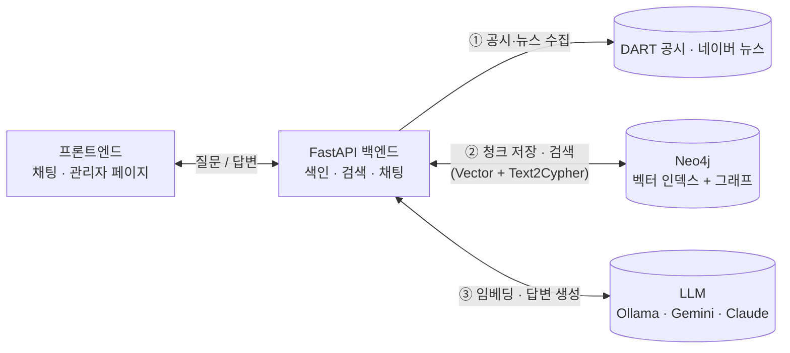

# 기업 리포트 챗봇(RAG) — Python/FastAPI

DART 전자공시(사업/반기/분기보고서 + 지분공시)와 관련 뉴스를 근거로 관심 기업에
답변하는 RAG 챗봇입니다. 기존 Spring Boot 구현(`rag-company-report`)을 파이썬으로
그대로 포팅했고, **Neo4j 노드 스키마(라벨·`metadata.*` 속성·벡터 인덱스 이름)와
REST API 경로가 동일**해서 같은 Neo4j 인스턴스와 같은 프론트엔드를 그대로 씁니다.

## 아키텍처



- **① 수집**: DART 공시(XML)는 목차(`TITLE ATOC="Y"`) 단위로 분해, 뉴스는 네이버
  검색결과·기사 페이지를 파싱(API 키 불필요)해서 본문을 가져옵니다. 둘 다 청킹 후
  같은 기업 전용 Neo4j 인덱스에 저장되고(뉴스는 `doc_type=NEWS`), 지분공시 제출인/
  기사-언론사 관계는 그래프로도 기록됩니다. 해시가 같은 공시와 이미 수집한 기사
  URL은 재수집하지 않습니다.
- **② 검색**: 질문을 임베딩해 기업 전용 인덱스에서 유사도 검색(뉴스 키워드면
  `doc_type=NEWS`로 필터). 집계·랭킹처럼 벡터 검색만으로 안 되는 그래프 질문이면
  LLM이 즉석에서 Cypher를 생성해 읽기 전용 세션으로 실행(Text2Cypher), 실패하면
  검색된 청크에 앵커된 고정 Cypher(VectorCypher)로 폴백합니다.
- **③ 생성**: 로컬(Ollama)/Gemini/Claude CLI 중 골라서 답변합니다.

## 실행

```bash
python -m venv .venv && . .venv/bin/activate
pip install -e ".[dev]"
cp .env.example .env   # DART_API_KEY 등 채우기

# Neo4j(벡터 인덱스 지원 5.x 이상)와 Ollama가 떠 있어야 합니다.
ollama pull bge-m3 && ollama pull qwen2.5:3b

uvicorn app.main:app --port 8080
```

- 채팅: http://localhost:8080/
- 관리자: http://localhost:8080/admin.html
- API 문서: http://localhost:8080/docs

`static/`은 기존 프로젝트에서 빌드된 프론트엔드 번들을 그대로 가져온 것입니다.
프론트엔드를 수정하려면 원 프로젝트(`frontend/`)에서 빌드해 이 디렉터리에 덮어씁니다.

## API

| 메서드 | 경로 | 설명 |
| --- | --- | --- |
| GET | `/api/company-report/watchlist` | 워치리스트 기업 목록 |
| POST | `/api/company-report/index?bgn_de=&end_de=` | 정기공시(A)+지분공시(D) 색인. 기본 최근 2년 |
| POST | `/api/company-report/chat` | 질문 답변 (`question`, `corpCode`, `history`, `topK`, `provider`) |
| POST | `/api/admin/news/fetch` | 워치리스트 기업 최근 뉴스 수집·색인 |
| GET/POST/DELETE | `/api/admin/documents` | 관리자 PDF 업로드 문서 관리 |
| GET | `/api/admin/indexed-chunks` | 색인된 청크 뷰어 (`corpCode`, `sourceType`, `limit`, `offset`) |
| GET | `/api/admin/graph/filers` | 특정 기업 지분공시 제출인 |
| GET | `/api/admin/graph/related-companies` | 제출인이 지분을 공시한 다른 기업(멀티홉) |

`provider`는 `local`(Ollama, 기본값) · `gemini`(=`cloud`) · `claude`(로컬 `claude` CLI).

## 소스 구성

```
app/
  config.py            설정(.env) — application.yml 대응
  watchlist.py         관심 기업 고정 목록
  dart/                DART Open API 클라이언트 + 공시 XML 목차 파서
  naver/               네이버 뉴스 검색결과/기사 본문 스크래퍼 (API 키 불필요)
  llm/                 Ollama(채팅+임베딩) · Gemini REST · Claude CLI
  vector/              Document · 토큰 청킹 · Neo4j 벡터스토어 · 기업별 스토어 레지스트리
  services/            색인 · 뉴스 수집 · 공시/뉴스 그래프 · 청크 뷰어 · PDF · 채팅
  routers/             FastAPI 엔드포인트
  dependencies.py      싱글턴 조립(DI 컨테이너)
```

## Java 구현과의 차이

- Spring AI `TokenTextSplitter`(cl100k_base, 800토큰)와 청킹 규칙을 동일하게 옮겨서
  같은 인덱스를 공유해도 청크 경계가 어긋나지 않습니다.
- 벡터 검색의 메타데이터 필터는 Spring AI와 마찬가지로 ANN 검색 이후 적용되는
  post-filter입니다(뉴스 필터 시 후보군을 200개로 넓힌 뒤 topK로 잘라내는 이유).
- PDF 텍스트 추출은 `PagePdfDocumentReader` 대신 `pypdf` 페이지 단위 추출입니다.

## 테스트

```bash
pytest
```

XML 목차 파서, 청킹, 채팅 프롬프트/폴백 헬퍼, 청크 필터, DART 응답 파싱을 외부
의존성 없이 검증합니다.
