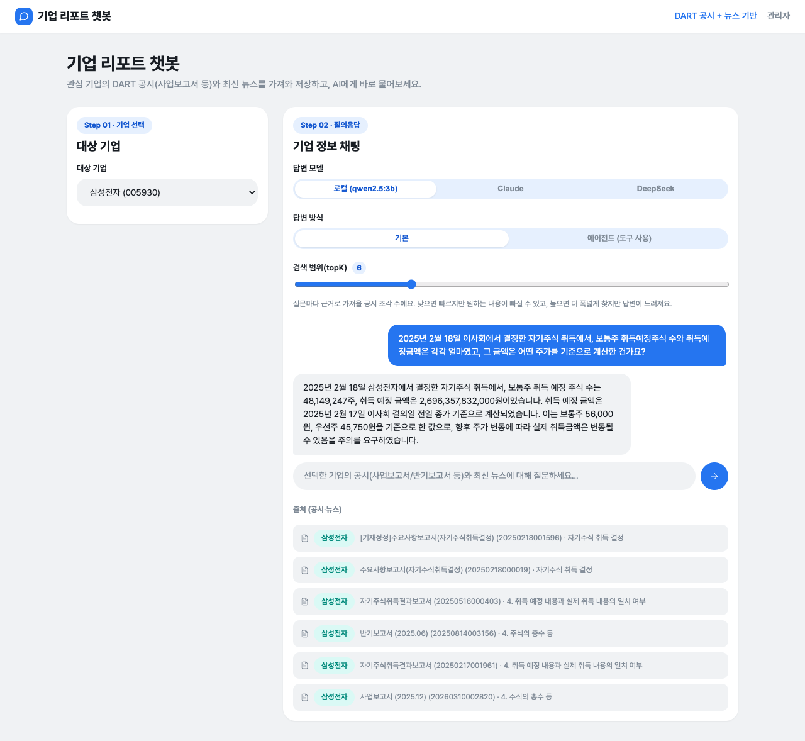
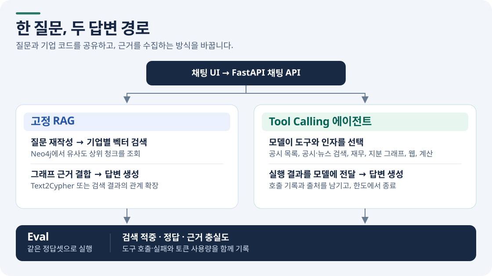
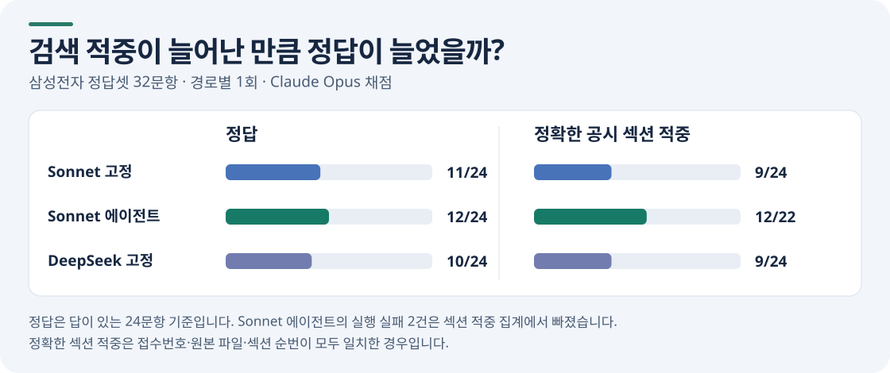
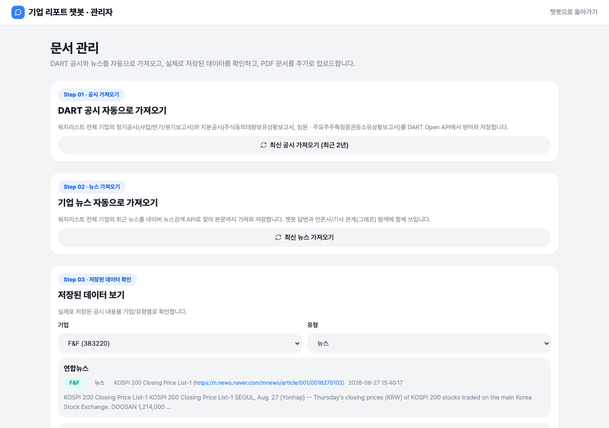

# 기업 공시 RAG 챗봇 개선 | Tool Calling과 Eval

**공시 질문에 맞는 도구를 모델이 직접 고르면, 더 정확하게 답할 수 있을까?** DART 공시와 뉴스를 검색하는 기업 리포트 챗봇에 Tool Calling 경로를 추가하고, 같은 질문을 기존 RAG와 에이전트에 던져 차이를 측정했습니다. 비교 결과를 문항별로 추적해 **검색에서 근거를 놓친 경우**와 **근거를 찾고도 잘못 답한 경우**를 확인했습니다.

Python/FastAPI · Neo4j · Ollama · Claude CLI/MCP · DeepSeek API · Vue 3

*Ollama로 실행한 기본 모드 화면. 모델과 답변 방식을 고를 수 있고, 검색한 공시의 보고서명·접수번호·섹션을 확인할 수 있습니다.*

## 목표와 구현 범위

기존 고정 RAG는 기업별 Neo4j 벡터 인덱스에서 질문과 비슷한 청크를 가져오고, 필요한 경우 그래프 조회를 더합니다. 특정 날짜의 공시를 찾고, 공시 내 수치를 확인한 뒤 계산하는 질문은 여러 단계가 필요합니다. **질문마다 근거를 찾는 방법을 바꾸는 경로**를 추가하고, 정확도와 실행 비용을 함께 비교하는 것이 이번 개발의 목표였습니다.

제가 구현한 범위는 답변 경로와 도구 실행기, 평가 정답셋 및 비교 CLI, 모델·답변 방식 선택 UI입니다. 공시 수집 배치의 중복 제거, 재시도, 정정 공시 연결도 개선해 검색에 사용할 데이터 기반을 마련했습니다.

## Tool Calling으로 답변 경로 확장

- **도구 계약을 정의했습니다.** 공시·뉴스 벡터 검색, 최신 공시 목록, DART 주요 재무계정, 지분 그래프, 웹 검색, 계산을 각각 입력 스키마와 결과 형식이 있는 도구로 구현했습니다. Ollama와 DeepSeek는 공통 실행 루프에 연결하고, Claude CLI에는 동일한 도구를 MCP로 제공했습니다.
- **호출을 추적할 수 있게 만들었습니다.** 입력을 검증하고 같은 인자의 반복 호출과 호출 한도를 제어했습니다. 성공 여부, 입력, 결과, 출처를 기록해 답변이 어떤 근거에서 나왔는지 확인할 수 있게 했습니다. FastAPI 응답은 답변, 출처, 에이전트 호출 기록을 반환합니다.
- **실제 평가에서 호출 순서를 확인했습니다.** 삼성전자 자기주식 처분 문항 `q0013`에서 Sonnet은 공시 목록 조회 → 공시 본문 검색 → 계산 순으로 도구를 사용했습니다. 세 호출이 모두 성공했고 Claude Opus 채점에서 정답으로 판정됐습니다.

[도구 정의](../app/agent/tools.py) · [공통 실행 루프](../app/agent/loop.py) · [MCP 서버](../app/agent/mcp_server.py) · [채팅 API](../app/routers/company_report.py)

## Eval로 검색과 답변을 각각 측정

1. **정답셋을 구성했습니다.** 공시 유형별로 원문 섹션을 뽑고 후보 질문을 검수했습니다. 질문마다 기대 섹션과 핵심 사실을 넣고, 근거가 없으면 답을 보류해야 하는 질문도 포함했습니다. 삼성전자 32문항으로 시작해 SK하이닉스·현대자동차·KB금융·NAVER를 추가하며 5개 기업 52문항으로 확장했습니다.
2. **문항별로 기록했습니다.** 검색은 접수번호·원본 파일·섹션 순번의 일치 여부로 평가했습니다. 답변은 사실 포함 여부, 거절 판정, Claude Opus의 정답·근거 충실도 점수를 함께 봤습니다. 도구 호출 수·오류, 토큰 사용량, 정답셋 해시와 인덱스 상태도 저장해 실행 조건을 추적할 수 있게 했습니다.
3. **측정 오류를 수정했습니다.** 응답 끝의 단서도 거절로 잡히던 문제를 확인하고 답변 첫 200자만 검사하도록 수정했습니다. 저장된 Sonnet 고정 경로 답변에 새 규칙을 적용하니 답이 있는 문항의 거절 오탐은 **17/24 → 9/24**로 줄었습니다. 답이 없는 문항의 규칙상 거절 판정도 **8/8 → 7/8**로 줄어, 채점 규칙의 한계와 함께 기록했습니다.

[정답셋](../eval/dataset.yaml) · [평가 실행기](../app/eval/runner.py) · [실행 비교](../app/eval/compare.py) · [평가 실행 방법](../README.md#5-답변-평가)

## 비교 결과와 판단

*삼성전자 32문항 비교. Sonnet 에이전트의 답변 가능 문항 2개가 실행에 실패해 섹션 적중 집계에서는 제외했습니다. 세 경로 모두 답이 없는 8문항에서 적절히 답변을 보류했습니다.*

같은 Sonnet에서 **정확한 섹션을 찾은 문항은 9개에서 12개**, **정답은 11개에서 12개**로 늘었습니다. 평균 입력 토큰은 완료 문항 기준 약 **7.1천 → 30.7천**으로 증가했습니다. 각 경로를 한 번씩 실행했으므로 이 결과만으로 정답률 향상이 재현된다고 판단하기는 어렵습니다.

고정 경로의 오답 중 **Sonnet 13개 중 9개**, **DeepSeek 14개 중 9개**에서 필요한 섹션이나 같은 제목의 섹션을 찾지 못했습니다. 다음 비교에서는 52문항 정답셋을 고정하고, 키워드 검색 병행과 보고서 기간 필터를 각각 적용해 섹션 적중과 정답 변화가 함께 나타나는지 확인할 계획입니다. 확장 정답셋의 DeepSeek 에이전트 실행은 OpenRouter 402로 12/52문항만 완료돼 위 비교에서 제외했습니다.

## 외부 MCP 도구 추가와 64문항 비교

2026년 11월 27일, OpenDART와 pykrx의 데이터를 같은 에이전트 도구 목록에 연결했습니다. DeepSeek 에이전트에 같은 64문항과 공시 인덱스를 사용하고 Claude Opus로 답변을 채점했습니다. 최초 채점에서 빠진 51문항은 답변 생성과 채점을 함께 다시 실행했습니다.

| 지표 | 외부 도구 끔 | 외부 도구 켬 |
| --- | ---: | ---: |
| 기존 문항 정답 | 29/52 | 33/52 |
| 새 도구 문항 정답 | 10/12 | 12/12 |
| 정확한 공시 섹션 적중 | 34/50 | 28/50 |
| 실패한 도구 호출 | 4건 | 10건 |

기존 문항 정답이 2개 넘게 줄지 않고 새 문항 정답이 늘면 활성화한다는 기준을 충족해 외부 도구를 기본으로 켰습니다. 이후 KRX 인증을 검증하고 시가총액과 PER·PBR을 별도 도구로 추가했습니다. 병합된 버전의 채팅 API에서 두 호출과 KRX 출처를 확인했고, 실제 서버 연동을 포함한 테스트 348개가 통과했습니다.

[시간순 품질 개선 이력과 평가 조건](rag-quality-history.md) · [외부 도구 목록과 설정](../README.md#외부-mcp-도구)

## 공시와 뉴스 색인 확인 화면

*관리자 페이지에서 기업·자료 유형으로 색인 결과를 필터링하고 기사 원문을 확인할 수 있습니다.*
