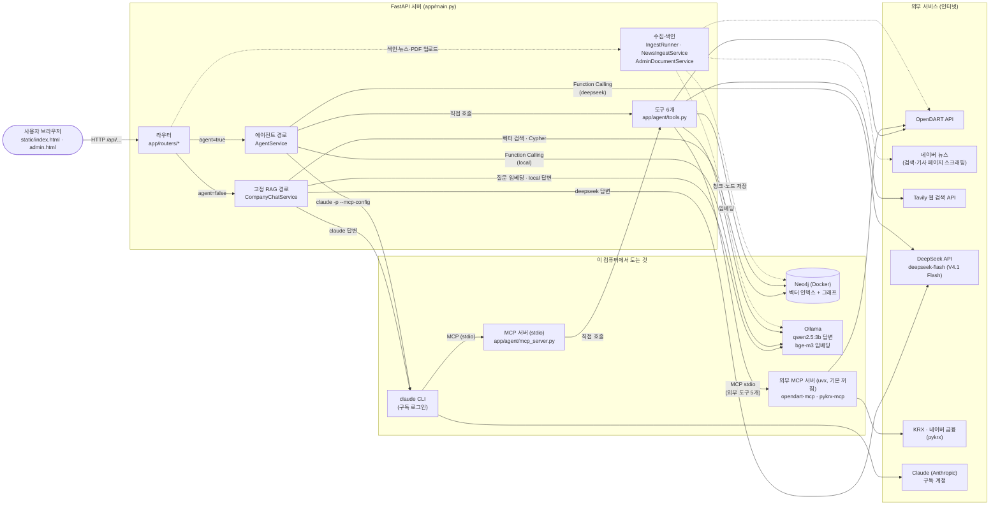
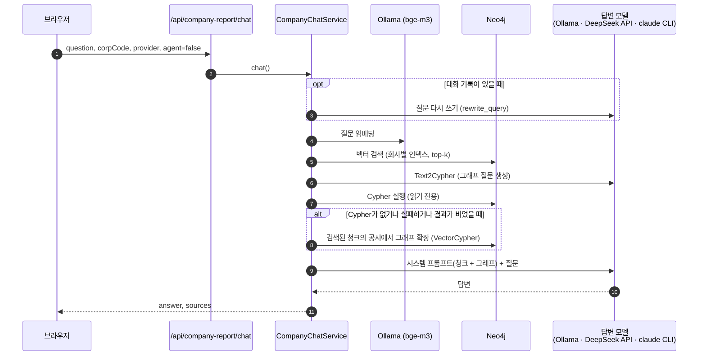
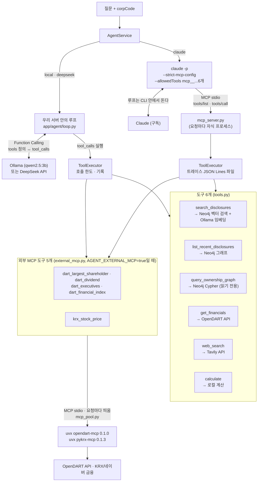
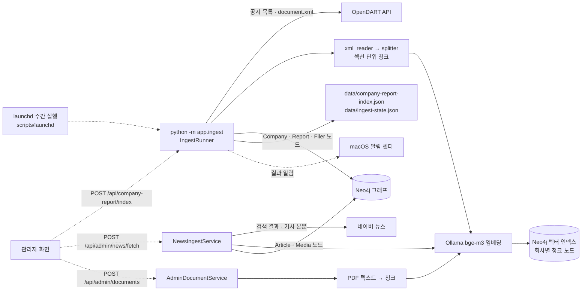
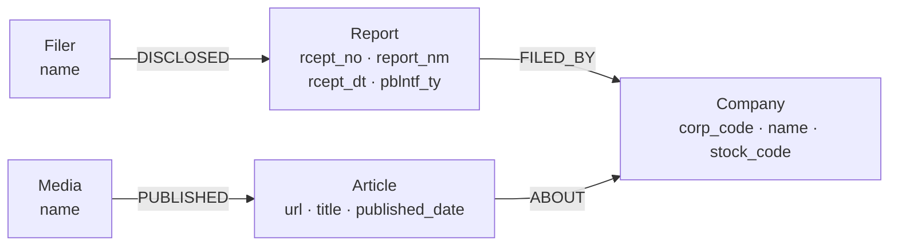
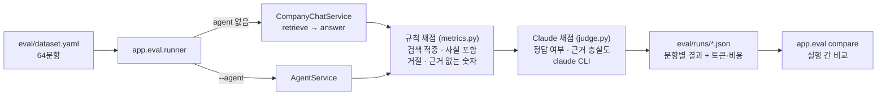

# 프로젝트 구조

이 문서는 기업 공시 챗봇이 어떤 부품으로 이루어져 있고, 부품끼리 무엇을 주고받는지 그림으로 보여 줍니다. 화살표는 호출 방향입니다. 점선은 매 요청이 아니라 배치나 수동 실행으로 일어나는 흐름입니다. 2026-11-27 기준입니다.

## 전체 그림

FastAPI 서버 하나가 화면, REST API, 답변 생성, 수집을 모두 맡습니다. 데이터는 전부 Neo4j 한 곳에 있습니다. 벡터 검색용 청크와 회사·공시·뉴스 그래프가 같은 DB에 들어 있습니다.

## 답변이 만들어지는 두 경로

채팅 요청의 `agent` 값이 경로를 고릅니다. `provider` 값(`local`, `deepseek`, `claude`)은 어느 모델이 답할지를 고릅니다.

### 고정 RAG 경로 (`agent=false`)

순서가 코드에 정해져 있습니다. 모델은 검색 결과를 받아 답만 씁니다.

### 에이전트 경로 (`agent=true`)

모델이 도구를 골라 부르고, 결과를 보고 다시 부르거나 답합니다. 한 질문에 도구 호출은 최대 6번입니다(`agent_max_tool_calls`). 도구 정의는 `app/agent/tools.py` 한 곳에 있고, 연결 방식만 provider마다 다릅니다.

Function Calling과 MCP의 차이는 연결하는 구간입니다.

- **Function Calling은 모델과 앱을 잇습니다.** 모델이 "이 도구를 이 인자로 불러 달라"고 답하고, 앱이 실행합니다. `local`과 `deepseek`는 우리 서버가 앱 역할을 하므로 도구 함수를 직접 부릅니다.
- **MCP는 앱과 도구 서버를 잇습니다.** `claude` 경로에서는 앱 역할을 `claude` CLI가 맡습니다. CLI는 우리 파이썬 함수를 직접 부를 수 없습니다. 그래서 같은 도구를 MCP 서버로 감싸 CLI에 붙입니다. CLI와 Claude 모델 사이는 여전히 Function Calling입니다.
- **외부 MCP 도구에서는 우리 앱이 MCP 클라이언트입니다.** `AGENT_EXTERNAL_MCP=true`이면 `mcp_pool.py`가 `opendart-mcp`와 `pykrx-mcp`를 띄우고 `tools/call`을 보냅니다. `local`과 `deepseek`에서는 우리 서버가 직접 부르고, `claude`에서는 우리 MCP 서버가 서버이면서 클라이언트가 되어 외부 서버로 중계합니다.

## 데이터가 들어오는 길

수집은 세 갈래입니다. 모두 텍스트를 청크로 나누고, Ollama `bge-m3`로 임베딩해, 회사별 Neo4j 벡터 인덱스(`company-report-index-{corp_code}`)에 넣습니다.

## Neo4j 그래프 모델

Text2Cypher와 `query_ownership_graph` 도구가 이 스키마로 Cypher를 씁니다. 쓰기 구문(`CREATE`, `MERGE`, `DELETE` 등)은 실행 전에 막습니다.

## 평가 파이프라인

`python -m app.eval run`은 정답셋으로 두 경로를 돌리고 채점합니다. 채점 모델은 `claude` CLI(기본 Opus)라 API 과금이 없습니다.

## 폴더와 역할

| 폴더 | 역할 |
| --- | --- |
| `app/routers` | REST API 입구. 채팅, 색인, 뉴스, 그래프, 관리자 문서 |
| `app/services` | 고정 RAG 답변, 색인, 그래프 조회, 뉴스·PDF 수집 |
| `app/agent` | 에이전트 루프, 도구 6개, 외부 MCP 도구 어댑터와 세션 풀, 실행기, MCP 서버, Claude CLI 연결 |
| `app/llm` | 모델 클라이언트. Ollama, `claude` CLI, OpenAI 호환(DeepSeek API), 사용량 기록 |
| `app/vector` | Neo4j 벡터 저장소, 회사별 인덱스 관리, 청크 분할 |
| `app/dart` | OpenDART API 클라이언트와 공시 XML 파서 |
| `app/naver` | 네이버 뉴스 검색·기사 스크래퍼 (API 키 없음) |
| `app/ingest` | 주간 수집 실행기, 상태 파일, 잠금, 알림 |
| `app/eval` | 정답셋, 실행, 규칙 채점, Claude 채점, 비교 |
| `static` | 빌드된 채팅·관리자 화면 |

## 사용하는 서비스

- **외부 API:** OpenDART, DeepSeek API(deepseek-flash), Tavily 웹 검색
- **외부 MCP 서버(기본 꺼짐):** opendart-mcp, pykrx-mcp(KRX·네이버 금융 시세)
- **Claude:** 로그인된 `claude` CLI(구독)
- **스크래핑:** 네이버 뉴스
- **로컬:** Neo4j(Docker), Ollama
