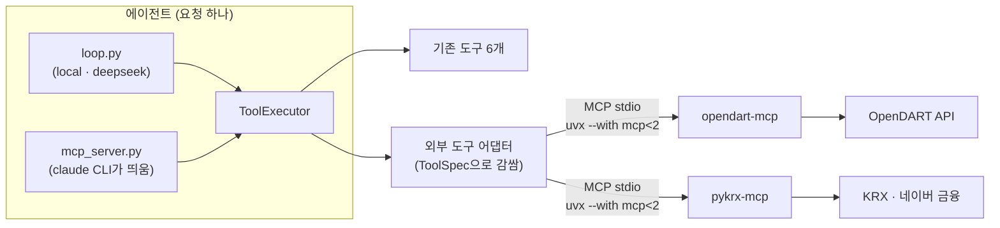

# 외부 MCP 서버를 에이전트 도구로 붙이기

2026-11-27 · 상태: 승인됨

## 왜 하는가

사용자가 원하는 것은 두 가지입니다.

1. **MCP를 클라이언트 쪽에서 배운다.** 지금 이 프로젝트는 MCP 서버(`app/agent/mcp_server.py`)만 있고, 그것도 `claude` CLI가 쓰는 내부용입니다. 남이 만든 MCP 서버에 접속해 도구를 받아 쓰는 쪽은 없습니다.
2. **답변을 낫게 한다.** 두 방향 모두입니다.
   - **기존 질문의 정확도를 올린다.** 지난 평가에서 기존 경로 오답 13~14개 중 9개는 맞는 공시 섹션을 못 찾아서였습니다. 최대주주, 배당, 임원, 재무지표처럼 DART가 구조화된 API로 주는 값은 벡터 검색 대신 실시간 조회로 정확히 가져올 수 있습니다.
   - **지금은 못 하는 질문을 하게 한다.** 주가와 거래량은 지금 어떤 도구로도 답할 수 없습니다.

## 목표

- 에이전트 경로가 외부 MCP 서버 두 개의 도구 일부를 기존 도구 6개와 함께 쓴다.
  - **OpenDART MCP:** `opendart-mcp` 0.1.0 (RealYoungk). DART 83개 API를 도구로 제공합니다.
  - **KRX 시세 MCP:** `pykrx-mcp` 0.1.3 (sharebook-kr, pykrx 관리 조직). 도구 8개와 함께 자료(resources) 2개, 질문 틀(prompts) 3개도 제공합니다.
- 세 provider(`local`, `deepseek`, `claude`)가 같은 외부 도구를 같은 이름, 같은 설명으로 본다.
- 정답셋에 새 도구가 필요한 문항을 추가하고, 붙이기 전과 후를 평가로 비교한다.

## 하지 않는 것

- 고정 RAG 경로(`agent=false`)는 바꾸지 않습니다.
- 우리 MCP 서버를 원격(HTTP)으로 공개하지 않습니다.
- 외부 서버의 자료와 질문 틀은 에이전트에 넘기지 않습니다. 도구만 씁니다. 학습용으로 읽어 보는 스크립트는 따로 둘 수 있습니다(빌더 판단).
- 외부 서버를 포크하거나 고치지 않습니다. 버전만 고정해서 그대로 씁니다.

## 실패로 보는 경우 (기술적으로 돌아가도)

- DART API 키가 모델 입력, 답변, 로그, 트레이스 파일, 평가 결과 파일 어디에든 남는다.
- 도구가 늘어서 기존 52문항의 정답 수나 도구 선택 정확도가 눈에 띄게 떨어진다.
- 외부 서버가 안 뜨거나 느려서 채팅 전체가 실패한다. 외부 도구가 없으면 기존 6개로 답해야 합니다.

## 제약

- **무료만 씁니다.** 두 서버 모두 무료입니다. OpenDART는 이미 쓰는 키를 그대로 씁니다(하루 1만 건). pykrx는 키가 없습니다.
- **Claude는 구독 CLI로만 씁니다.** API 키를 쓰지 않습니다(`CLAUDE.md`).
- **MCP SDK 버전이 다릅니다.** 이 저장소는 `mcp` 2.3을 씁니다. 두 외부 서버는 1.x의 `FastMCP`로 짜여 있어 2.x에서는 시작하지 않습니다. 그래서 같은 가상환경에 설치하지 않고, `uvx --with "mcp<2" <패키지>@<버전>`으로 따로 띄웁니다. 2.3 클라이언트와 1.x 서버 사이의 통신은 아래 확인에서 정상으로 동작했습니다.
- **실행 환경에 `uv`가 있어야 합니다.** 처음 실행할 때는 패키지를 내려받습니다.

## 붙이기 전에 확인한 것 (2026-11-27, 직접 실행)

| 항목 | 결과 |
| --- | --- |
| 외부로 나가는 곳 | `opendart-mcp` 코드가 접속하는 주소는 `https://opendart.fss.or.kr/api` 하나입니다. `pykrx-mcp` 코드 자체에는 주소가 없고, pykrx 라이브러리가 KRX와 네이버 금융에 접속합니다. 두 패키지 모두 `subprocess`, `eval`, 파일 쓰기가 없습니다. |
| 시작 시간 | 캐시된 뒤 `opendart-mcp` 약 0.3초, `pykrx-mcp` 약 0.6초입니다(초기화와 도구 목록 조회까지). |
| OpenDART 도구 | 최대주주, 배당, 임원, 단일회사 재무지표 모두 삼성전자 2025 사업보고서 값이 나왔습니다. |
| OpenDART 도구 정의 크기 | 83개 전체가 약 44,000자입니다. 전부 넘기면 매 호출 입력이 크게 늘어납니다. |
| OpenDART 오류 표현 | 데이터가 없으면 `is_error=false`인 채로 본문에 `{"status": "013", "message": "조회된 데이타가 없습니다."}`를 줍니다. |
| OpenDART 키 노출 위험 | 클라이언트가 HTTP 오류 때 `raise_for_status()`를 부릅니다. httpx 예외 문구에는 요청 URL이 들어가고, URL에 `crtfc_key`가 있습니다. FastMCP는 예외 문구를 도구 결과로 돌려주므로 키가 모델에게 갈 수 있습니다. |
| pykrx 도구 | **동작:** `get_stock_ohlcv`(일별 시가·고가·저가·종가·거래량)와 `get_market_ticker_name`. **실패:** `get_market_cap_by_date`, `get_market_fundamental_by_date`, `get_market_trading_value_by_date`가 최근 날짜와 2025년 1월 모두 "데이터 없음"을 줍니다. KRX 정보데이터시스템 응답이 JSON이 아니었습니다(로그 "Expecting value"). 시가총액, PER·PBR, 투자자별 거래대금은 이 서버로 얻을 수 없습니다. |
| pykrx 오류 표현 | 실패해도 `is_error=false`이고, 본문 JSON에 `"error"` 키가 있습니다. |

## 고려한 방법

| 방법 | 내용 | 판단 |
| --- | --- | --- |
| **A. 우리 앱을 MCP 클라이언트로 (선택)** | 에이전트가 외부 서버에 접속해 도구 목록을 받고, 고른 도구만 기존 도구 옆에 붙인다. 세 provider가 같은 도구를 쓴다. | **사용자 선택.** DeepSeek(다른 사람이 쓸 경로)까지 혜택이 가고, MCP 클라이언트 구조를 직접 만든다. |
| B. Claude CLI 설정에만 추가 | `--mcp-config`에 외부 서버를 넣는다. 코드가 거의 늘지 않는다. | DeepSeek 경로가 그대로라 서비스 품질에 도움이 없다. 키 가리기, 인자 고정, 오류 정리도 끼울 곳이 없다. |
| C. 우리 도구 안에서 외부 MCP를 라이브러리처럼 호출 | `get_market_data` 같은 우리 도구를 만들고 함수 안에서 MCP를 부른다. | 모델은 MCP가 있는지 모른다. MCP를 배우려는 목적과 거리가 있다. |

## 설계

### 한 줄 요약

외부 MCP 도구를 기존과 같은 `ToolSpec`으로 바꿔 끼웁니다. 그러면 Function Calling 루프(`loop.py`)와 우리 MCP 서버(`mcp_server.py`) 둘 다 코드 변경 없이 새 도구를 봅니다. 차이는 `ToolSpec.run`이 파이썬 함수를 직접 부르는 대신 외부 MCP 서버의 `tools/call`을 부른다는 것뿐입니다.

Claude 경로에서는 우리 MCP 서버가 **MCP 서버이면서 동시에 MCP 클라이언트**가 됩니다. CLI가 보기에는 도구가 우리 서버 하나에서 나오고, 우리 서버가 외부 서버로 중계합니다. 그래서 `--allowedTools` 목록은 우리 서버 이름(`mcp__company-report-tools__...`) 아래에 새 도구 이름만 더하면 됩니다.

### 외부 서버와 도구 목록은 코드 한 곳에 표로 둔다

서버마다 다음을 적는 등록 표를 둡니다(예: `app/agent/external_mcp.py`).

- 서버 이름, 실행 명령(`uvx --with "mcp<2" opendart-mcp@0.1.0`처럼 버전 고정)
- 자식 프로세스에 넘길 환경변수. `OPENDART_API_KEY`는 설정의 `dart_api_key`에서 가져옵니다.
- 노출할 도구 목록(허용 목록)과, 도구마다 모델에게 보일 이름·설명

**1차로 노출할 도구 (제안).** 기존 6개에 5개를 더해 11개가 됩니다.

| 모델에게 보일 이름 | 외부 도구 | 쓰임 |
| --- | --- | --- |
| `dart_largest_shareholder` | `opendart-mcp` `get_largest_shareholder` | 최대주주와 특수관계인 지분 |
| `dart_dividend` | `opendart-mcp` `get_dividend_info` | 주당 배당금, 배당성향 |
| `dart_executives` | `opendart-mcp` `get_executive_status` | 임원 현황 |
| `dart_financial_index` | `opendart-mcp` `get_single_financial_index` | 수익성·안정성·성장성 등 재무지표 |
| `krx_stock_price` | `pykrx-mcp` `get_stock_ohlcv` | 기간별 일별 주가와 거래량 |

이름에 `dart_`, `krx_` 접두어를 붙여 기존 도구나 서로와 겹치지 않게 합니다. OpenAI 함수 이름 규칙(영문·숫자·`_`·`-`, 64자 이하)을 지킵니다. 설명은 외부 서버의 설명을 그대로 쓰지 않고 우리가 한국어로 짧게 다시 씁니다. 외부 설명은 길고 인자 형식이 문자열 코드 위주라 모델이 헷갈리기 쉽습니다.

### 회사 인자는 모델에게 보이지 않고 우리가 넣는다

기존 도구는 현재 대화 중인 회사로 범위가 묶여 있습니다. 외부 도구도 같게 합니다.

- `opendart-mcp` 도구의 `corp_code`는 스키마에서 빼고, 실행할 때 요청의 `corp_code`를 넣습니다.
- `pykrx-mcp`의 `ticker`도 스키마에서 빼고, `WATCHLIST`의 `stock_code`로 넣습니다.
- `reprt_code`처럼 모델이 고르기 어려운 코드 값은, 기존 `get_financials`처럼 `annual`·`half`·`q1`·`q3` 선택지로 보여 주고 변환해서 넘깁니다.

다른 회사를 비교하는 질문은 1차 범위에서 제외합니다. 기존 도구도 워치리스트 밖은 막고 있습니다.

**모델이 고르는 인자 (설계자 판단).**

| 도구 | 모델이 넘기는 인자 | 우리가 고정하거나 변환하는 값 |
| --- | --- | --- |
| `dart_largest_shareholder`, `dart_dividend`, `dart_executives` | `year`(정수, 2015 이상), `report`(`annual`·`half`·`q1`·`q3`, 기본 `annual`) | `corp_code` 주입, `bsns_year`는 문자열로, `reprt_code`는 `REPORT_CODES`로 변환 |
| `dart_financial_index` | 위 두 개 + `category`(`profitability`·`stability`·`growth`·`activity`) | `idx_cl_code`로 변환(`M210000`·`M220000`·`M230000`·`M240000`) |
| `krx_stock_price` | `start_date`, `end_date`(`YYYY-MM-DD`). 기간은 최대 31일 | `ticker` 주입, 날짜는 `YYYYMMDD`로 변환. `adjusted`는 기본값 `true`를 그대로 씁니다. 확인한 동작 경로가 이것이고, pykrx에서 `false`는 실패하는 KRX 경로를 탑니다. 31일치 일별 행은 한 줄 JSON으로 4,000자 안에 들어갑니다. |

기간이 31일을 넘으면 실행 전에 오류로 돌려주고, 모델이 기간을 줄여 다시 부르게 합니다.

### 결과를 정리해서 모델에게 준다

외부 결과는 그대로 넘기지 않고 다음을 거칩니다.

1. **키 가리기.** 결과 텍스트와 오류 문구에서 DART 키를 `***`로 바꿉니다. 기존 `app/ingest/notify.py`의 `redact()`(`crtfc_key=...`)와 키 문자열 자체를 둘 다 가립니다. 트레이스 기록과 평가 파일도 이 정리된 텍스트만 받습니다.
2. **오류 판정.** 다음은 `ToolResult(ok=False)`로 바꿉니다.
   - MCP `is_error=true`인 경우.
   - DART 본문의 `status`가 `000`이 아닌 경우. 메시지를 함께 보여 줍니다(예: "013 조회된 데이타가 없습니다").
   - pykrx 본문 JSON에 `error` 키가 있는 경우.
3. **줄이기.** 들여쓰기된 JSON을 한 줄 JSON으로 다시 쓰고, 모델에게 필요 없는 반복 필드(`corp_code`, `corp_cls`, `corp_name` 등)는 뺍니다. 그다음 기존 `ToolResult.of`의 4,000자 상한을 적용합니다.
4. **출처 (설계자 판단).** 응답 모델(`SourceItem`)과 화면은 바꾸지 않습니다. `app/agent/service.py`의 `_collect_sources`에 `kind == "external"` 분기를 더합니다.
   - DART 결과는 결과 행의 `rcept_no`로 `SourceItem(corpName=회사명, reportNm="DART API · <도구 설명>", rceptNo=rcept_no, docType="DART_API")`를 만듭니다.
   - KRX 결과는 `SourceItem(reportNm="KRX 시세 (pykrx) <시작일>~<종료일>", docType="KRX")`로 만듭니다.
   - 화면은 `docType`을 태그로 보여 주므로 프론트 수정 없이 구분됩니다.

**키는 결과 밖에서도 가립니다 (설계자 판단).** 자식 프로세스에는 필요한 환경변수만 넘깁니다(`OPENDART_API_KEY`, `PATH`, `HOME`, `uv` 캐시 경로). 자식의 stderr는 그대로 흘려보내지 않고 받아서 키를 가린 뒤 로그에 남깁니다(`stdio_client`의 `errlog`). `app/agent/claude_agent.py`가 CLI 실패 때 stderr를 예외 문구에 넣는 곳도 같은 가리기를 거칩니다.

### 연결은 요청마다 열고 닫는다

에이전트 요청 하나가 시작될 때 외부 서버를 띄우지 않습니다. 그 서버의 도구가 **처음 호출될 때** 띄우고, 요청이 끝나면 닫습니다. 시작 비용이 0.3~0.6초라 요청마다 띄워도 됩니다. 앱 전체에서 연결을 오래 유지하면 끊김 감지와 재연결 코드가 필요한데, 1차에서는 그 복잡도를 피합니다. Claude 경로의 우리 MCP 서버도 이미 요청마다 뜨므로 수명이 같습니다.

도구 목록(스키마)은 서버를 띄우지 않고도 알 수 있어야 합니다. 모델에게 도구 정의를 먼저 보내야 하기 때문입니다. 그래서 노출할 도구의 스키마는 등록 표에 직접 적어 둡니다. 서버에서 받은 스키마와 맞는지는 테스트(또는 시작 점검)로 확인합니다.

`ToolSpec.run`은 동기 함수이고 MCP 클라이언트는 비동기입니다. 동기 코드에서 비동기 세션을 부를 다리가 필요합니다. 방법은 빌더가 고릅니다(예: 요청 동안 살아 있는 이벤트 루프 스레드, `anyio.from_thread.start_blocking_portal`).

### 실패해도 채팅은 계속된다

- 외부 서버가 안 뜨거나(`uv` 없음, 패키지 다운로드 실패), 시간 초과가 나면 그 호출만 `ok=False`로 "외부 도구 사용 불가"를 돌려줍니다. 모델은 기존 도구로 계속 답합니다.
- 설정 `agent_external_mcp`로 외부 도구 전체를 켜고 끕니다. 꺼져 있으면 도구 목록에서도 빠집니다. **병합할 때 기본값은 꺼짐입니다(사용자 결정).** 아래 평가를 통과하면 켭니다. 2026-11-27 평가를 통과해 기본값을 켬으로 바꿨습니다.
- 호출 한도(`agent_max_tool_calls`, 6회)는 외부 도구도 똑같이 셉니다. DART `013`(데이터 없음)처럼 `ok=False`인 호출도 한 번으로 셉니다. `ToolExecutor`는 바꾸지 않습니다. 반복 차단은 같은 인자일 때만 걸리므로, 모델이 연도를 바꿔 다시 부르는 것은 막히지 않습니다. 한도를 올릴지는 평가 결과를 보고 정합니다.
- `krx_stock_price`가 구현 시점에 확인 때처럼 동작하지 않으면 이 도구만 빼고 진행합니다. DART 도구 4개는 그대로 둡니다.

### 도구 이름 목록

`TOOL_NAMES`는 기존 6개로 두고, 외부 도구 이름은 등록 표에서 나옵니다. 둘을 합친 "알려진 도구 이름" 목록을 하나 만듭니다.

- 정답셋 검사(`expected_tools`)는 설정과 상관없이 이 합친 목록으로 검사합니다.
- `--allowedTools`와 모델에게 보내는 도구 목록은 설정이 켜져 있을 때만 외부 도구를 포함합니다.
- 외부 도구를 끈 채로 평가하면 새 문항도 그대로 돌립니다. 그 문항들의 점수가 "외부 도구가 없을 때"의 기준선이 됩니다.

### 시스템 프롬프트

도구 사용 규칙(`app/agent/prompts.py`)에 다음을 더합니다.

- 최대주주, 배당, 임원, 재무지표처럼 정해진 항목은 `dart_*` 도구를 먼저 씁니다.
- 주가와 거래량은 `krx_stock_price`를 씁니다. 기존 규칙 2에서 "주가"를 `web_search` 예시에서 뺍니다.

### 평가

1. **기존 52문항 회귀.** 외부 도구를 켜고 끈 두 상태로 DeepSeek 에이전트를 돌려 정답 수와 도구 선택을 비교합니다. OpenRouter 크레딧이 필요합니다.
   - **켜는 기준 (사용자 결정).** 기존 52문항 정답이 끈 상태보다 2문항 넘게 줄지 않고, 새 문항 정답이 끈 상태보다 늘면 `agent_external_mcp` 기본값을 켬으로 바꿉니다. 2문항은 한 번 실행의 흔들림 범위로 봅니다.
   - 기준을 못 넘으면 도구 설명과 시스템 프롬프트를 고치거나, 도움이 안 되는 도구를 빼고 다시 잽니다.
2. **새 문항.** 새 도구가 필요한 문항을 추가합니다. `expected_tools`에 새 도구 이름을 적을 수 있도록 `app/eval/dataset.py`의 도구 이름 검사를 새 목록으로 넓힙니다.
   - 최대주주 지분율, 주당 배당금, 임원 수, 재무지표 같은 문항. 정답은 DART 값이고, 2025 사업보고서처럼 기준을 질문에 적습니다.
   - 주가 문항은 지난 날짜(예: "2026년 11월 20일 종가")로 고정해 정답이 바뀌지 않게 합니다.
3. 결과는 `docs/rag-quality-history.md`에 기록합니다.

### 문서

- `docs/architecture.md`의 전체 그림과 에이전트 경로 그림에 외부 MCP 두 개를 추가합니다.
- README의 에이전트 도구 표와 `.env` 설명을 갱신합니다.

## 테스트

- **어댑터 단위 테스트.** 테스트 안에서 작은 가짜 MCP 서버(stdio)를 띄웁니다. 다음을 확인합니다.
  - 허용 목록에 있는 도구만 노출되는가.
  - `corp_code`와 `ticker`가 주입되는가.
  - `status` 오류와 `error` 키가 `ok=False`로 바뀌는가.
  - 키가 결과와 트레이스에서 가려지는가.
  - 서버가 안 뜰 때 `ok=False`로 끝나는가.
- **스키마 일치 테스트.** 등록 표의 스키마가 실제 외부 서버의 `tools/list`와 맞는지 확인합니다. 네트워크와 `uv`가 필요하므로 표시를 달아 기본 실행에서는 건너뜁니다.
- **수동 스모크.** 세 provider로 "삼성전자 2025년 주당 배당금"과 "2026-11-20 종가"를 물어 답과 출처를 확인합니다.

## 빌더에게 맡기는 것

- 동기·비동기 다리의 구현 방식
- 결과에서 뺄 필드의 정확한 목록
- 시간 초과 값(외부 호출 하나당)
- 학습용으로 외부 서버의 자료·질문 틀을 읽어 보는 스크립트를 둘지 여부
